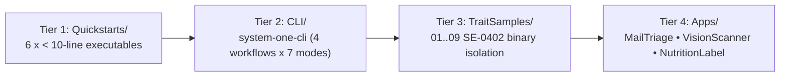

# Examples & Reference Applications 📱💻

`Examples/` is organized into a **4-tier learning progression**, taking you from `< 10`-line single-file provider quickstarts up to production multi-window SwiftUI applications for iOS 27+ and macOS 27+:



> [!IMPORTANT]
> **Strict Real Execution Mandate (Principle 7)**: Example applications and CLI demonstrators are production-representative showcases, **not unit tests**. They **never embed mock fallbacks or synthetic offline responses**. Missing credentials, Core ML models, or local daemons trigger a formatted remediation banner and immediate `exit(1)`. Offline mocks live strictly in [`Tests/`](../Tests/README.md).

---

## 🧭 Full 6-Provider + Proxy Coverage Matrix

| Provider / Mode | Tier 1: [`Quickstarts/`](Quickstarts/README.md) | Tier 2: [`CLI/`](CLI/README.md) (`--provider`) | Tier 3: [`TraitSamples/`](TraitSamples/README.md) | Tier 4: [`Apps/`](Apps/README.md) |
| :--- | :--- | :--- | :--- | :--- |
| **Laya On-Device** (`LayaOnDevice`) | `laya-ondevice-quickstart` | `laya-ondevice` (text) | `01-OfflineLayaApp`, `04-HybridRouter` | `MailTriageApp`, `NutritionLabelScannerApp` |
| **Laya HTTP** (`LayaFoundationModels`) | `laya-quickstart` | `laya` (text) | `03-PrivateLayaServer`, `04`, `05`, `09` | `MailTriageApp`, `NutritionLabelScannerApp` |
| **TypeSafe Jev** (`JevFoundationModels`) | `jev-quickstart` | `jev` (text) | `02-CloudJevWorker`, `04`, `05`, `09` | `MailTriageApp`, `NutritionLabelScannerApp` |
| **Cloudflare Clef** (`ClefFoundationModels`) | `clef-quickstart` | `clef` (text + **vision**) | `06-EdgeClefVision`, `04`, `05`, `09` | `MailTriageApp`, `VisionScannerApp`, `NutritionLabelScannerApp` |
| **OpenAI (`gpt-6-luna`)** (`OpenAIFoundationModels`) | `openai-quickstart` | `openai` (text + **vision**) | `07-CloudOpenAIDecisions`, `04`, `05`, `09` | `MailTriageApp`, `VisionScannerApp`, `NutritionLabelScannerApp` |
| **Gemini (`gemini-decision-1`)** (`GeminiFoundationModels`) | `gemini-quickstart` | `gemini` (text + **vision**) | `08-CloudGeminiDecisions`, `04`, `05`, `09` | `MailTriageApp`, `VisionScannerApp`, `NutritionLabelScannerApp` |
| **Authenticated Proxy** (`ProxyCredential` / `SystemOneProxyBackend`) | *(via provider `init(proxyEndpoint:credential:)`)* | `proxy` (text + **vision**) | `05-SecureAppCheckApp`, `09-RemotePersonaRouter` | `MailTriageApp`, `VisionScannerApp`, `NutritionLabelScannerApp` |

---

## ⚡ Tier 1: `< 10`-Line Provider Quickstarts ([`Examples/Quickstarts/`](Quickstarts/README.md))

Every System One provider supports zero-argument initialization (`init()`) with automatic environment resolution. Run any of the 6 quickstarts directly from the repository root:

```bash
TYPESAFE_API_KEY="ts_..."                              swift run jev-quickstart
swift run laya-quickstart                              # expects laya-serve or LAYA_SERVE_URL
LAYA_MODEL_PATH="/path/to/LayaDecisionModel.mlmodelc"  swift run laya-ondevice-quickstart
CLOUDFLARE_ACCOUNT_ID="..." CLOUDFLARE_API_TOKEN="..." swift run clef-quickstart
OPENAI_API_KEY="sk-..."                                swift run openai-quickstart
GEMINI_API_KEY="AIza..."                               swift run gemini-quickstart
```

See [**`Examples/Quickstarts/README.md`**](Quickstarts/README.md) for verbatim source listings.

---

## 💻 Tier 2: Unified Multi-Provider CLI ([`Examples/CLI/`](CLI/README.md) — `system-one-cli`)

Run any of the 4 showcase workflows against any of the 7 provider modes (`--provider jev|laya|laya-ondevice|clef|openai|gemini|proxy` or `SYSTEM_ONE_PROVIDER`):

```bash
swift run system-one-cli --help

# 1. Calibrated Ticket Triage & RoutingPolicy
TYPESAFE_API_KEY="..." swift run system-one-cli --provider jev ticket-triage

# 2. Two-Layer Deterministic + Concurrent Semantic Article Deduplication
OPENAI_API_KEY="..." swift run system-one-cli --provider openai duplicate-article

# 3. DynamicProfile Directory Organizer + Local Secret Redaction
TYPESAFE_API_KEY="..." swift run system-one-cli --provider jev file-organizer --demo

# 4. Multimodal Camera / Image Inspection (@Generable VisualInspectionDecision)
GEMINI_API_KEY="..." swift run system-one-cli --provider gemini vision-inspect
```

See [**`Examples/CLI/README.md`**](CLI/README.md) for all subcommand flags, `.env` resolution, and copy-pasteable provider matrices.

---

## 🧩 Tier 3: Swift 6.1 Package Trait Samples ([`Examples/TraitSamples/`](TraitSamples/README.md))

Standalone Swift packages proving compile-time target isolation via SE-0402 traits (`#if canImport(...)` verified):

| Sample | Active Trait | Linked Provider Target(s) | Highlights |
| :--- | :--- | :--- | :--- |
| [**01-OfflineLayaApp**](TraitSamples/01-OfflineLayaApp/README.md) | `["Laya"]` | `LayaOnDevice` | 100% offline Apple Neural Engine evaluation; zero HTTP code linked. |
| [**02-CloudJevWorker**](TraitSamples/02-CloudJevWorker/README.md) | `["Jev"]` | `JevFoundationModels` | Lean cloud worker; zero Core ML linkage. |
| [**03-PrivateLayaServer**](TraitSamples/03-PrivateLayaServer/README.md) | `["LayaServe"]` | `LayaFoundationModels` | VPC / self-hosted `laya-serve` cluster scoring. |
| [**04-HybridRouter**](TraitSamples/04-HybridRouter/README.md) | `["All"]` | All 6 Providers | Local-first ANE evaluation escalating to cloud when confidence $< 80\%$. |
| [**05-SecureAppCheckApp**](TraitSamples/05-SecureAppCheckApp/README.md) | `["Remote"]` | All 5 Remote Providers + `ProxyCredential` | Multi-provider zero-secret hardware attestation via Firebase App Check (Pattern A & Pattern B). |
| [**06-EdgeClefVision**](TraitSamples/06-EdgeClefVision/README.md) | `["Clef"]` | `ClefFoundationModels` | Cloudflare Workers AI / local Clef multimodal vision inspection. |
| [**07-CloudOpenAIDecisions**](TraitSamples/07-CloudOpenAIDecisions/README.md) | `["OpenAI"]` | `OpenAIFoundationModels` | Enterprise release-gate triage on OpenAI Decisions (`gpt-6-luna`). |
| [**08-CloudGeminiDecisions**](TraitSamples/08-CloudGeminiDecisions/README.md) | `["Gemini"]` | `GeminiFoundationModels` | Calibrated trust & safety triage linking only `GeminiFoundationModels`. |
| [**09-RemotePersonaRouter**](TraitSamples/09-RemotePersonaRouter/README.md) | `["Remote"]` | All 5 Remote Providers | Compiles `Jev`, `LayaServe`, `Clef`, `OpenAI`, `Gemini` while excluding `LayaOnDevice`. |

See [**`Examples/TraitSamples/README.md`**](TraitSamples/README.md) for full instructions.

---

## 📱 Tier 4: Native SwiftUI Reference Applications ([`Examples/Apps/`](Apps/README.md))

| Application | Platforms | Providers Supported | Highlights |
| :--- | :--- | :--- | :--- |
| [**MailTriageApp**](Apps/MailTriageApp/README.md) | macOS 27+ & iOS 27+ | All 6 + Proxy + Apple Generative Baseline | 3-pane Mail client with Liquid Glass UI, FactoryKit DI, batch triage, and 500-email benchmark suite. |
| [**VisionScannerApp**](Apps/VisionScannerApp/README.md) | macOS 27+ & iOS 27+ | `Clef`, `OpenAI`, `Gemini` + Proxy | Live AVFoundation camera viewfinder & photo import (`vision-scanner-app`) evaluating `VisualInspectionDecision`. |
| [**NutritionLabelScannerApp**](Apps/NutritionLabelScannerApp/README.md) | iOS 27+ | All 6 + Proxy | Live barcode + Vision OCR + multimodal packaging analysis across 5 dietary safety profiles. |

See [**`Examples/Apps/README.md`**](Apps/README.md) for side-by-side app comparisons and FlowDeck build commands.
