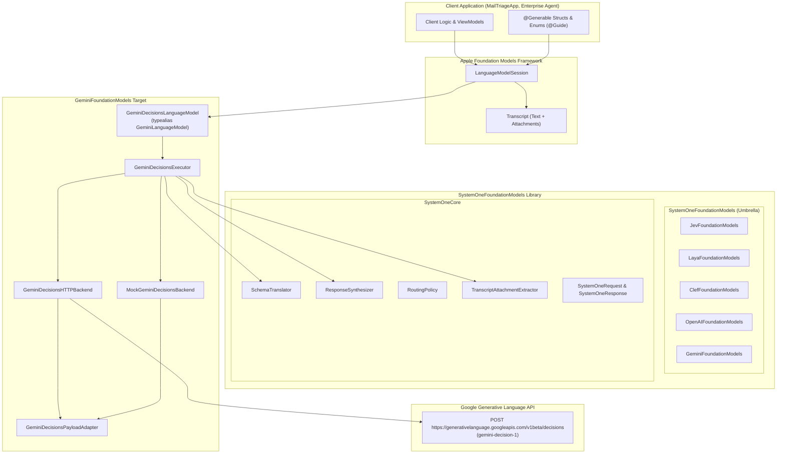
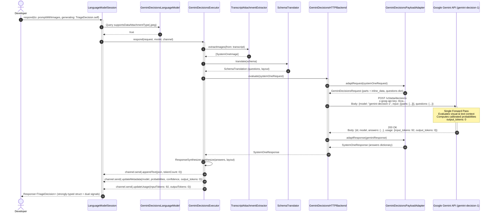

# ADR-2026-11-11-01: Google Gemini Decisions API (Gemini Decision 1) Model Integration

- **Status**: Proposed
- **Date**: 2026-11-11
- **Author**: Senior Architect Agent
- **PRD Reference**: `docs/prd/PRD-2026-11-11-gemini-decisions-models.md`
- **Target Modules**: `SystemOneCore`, `GeminiFoundationModels`, `SystemOneFoundationModels`
- **Target Release**: SystemOneFoundationModels 1.4.0 (iOS 27.0+, macOS 27.0+, visionOS 27.0+)

---

## 1. Context & Problem Statement

Modern client applications, reactive user interfaces, and autonomous agent workflows on Apple platforms require constant, high-frequency micro-decisions:
- **Inbound Content & Email Triage**: Classifying urgency, identifying customer sentiment, categorizing intent, and routing tickets to specialized escalation queues.
- **Multimodal Visual Verification**: Verifying whether a captured photo is blurry, whether an uploaded receipt or identity document exhibits tampering or glare, or whether physical merchandise arrived damaged.
- **Agent Action Selection & Guardrails**: Evaluating whether a proposed tool call violates security policies, selecting the next state transition in an automated workflow, or determining whether a user confirmation modal is mandated.
- **Form Validation & Smart Field Auto-Fill**: Determining data consistency, detecting anomalies across multi-field submissions, and selecting contextual fallback values.

### The Generative LLM Dilemma in System One Workflows
Historically, developers implementing these decision and routing pipelines have been forced to repurpose autoregressive generative Large Language Models (such as Gemini 1.5 Pro, Gemini 2.0 Flash, GPT-4o, or Claude 3.5 Sonnet) via conversational chat or structured JSON generation endpoints. This architectural mismatch introduces severe operational liabilities:

1. **Excessive Autoregressive Latency**: Standard conversational and `generateContent` endpoints take 1,000ms to 2,500ms end-to-end to autoregressively decode descriptive text, markdown delimiters, or structured JSON token sequences. In mobile applications and multi-step agent loops, this latency destroys real-time interactivity.
2. **Fragility of Output Generation**: Forcing an autoregressive model to produce structured JSON requires constrained grammar decoding or prompt engineering. Models can still hallucinate conversational prose, emit malformed syntax, or suffer from token-by-token exposure bias.
3. **Absence of Calibrated Probabilities**: Autoregressive decoders output token sequences rather than mathematically grounded epistemic probabilities. They cannot natively provide true Bayesian confidence scores for a boolean proposition or a normalized probability distribution over candidate categories or ordinal rubric levels.
4. **Asymmetric Token Pricing**: Generating conversational JSON payloads incurs both input token charges and steep output token pricing. For high-volume automated decision pipelines, paying per output token for repetitive structural boilerplate is economically inefficient.

### The Google Gemini Decisions Breakthrough: `gemini-decision-1`
On November 11, 2026, Google DeepMind and Google Cloud introduced the **Gemini Decisions API**, powered by **`gemini-decision-1`**—Google's purpose-built, non-autoregressive System One decision model hosted on the Generative Language API (`generativelanguage.googleapis.com`).

Key characteristics of the Gemini Decisions API:
- **Dedicated Endpoint**: `POST https://generativelanguage.googleapis.com/v1beta/decisions` (with model-scoped route compatibility).
- **Purpose-Built Objective**: High-speed triage, classification, routing, and rubric scoring in a single non-autoregressive forward pass without generating conversational text, markdown, or unstructured prose.
- **Native System One Dictionary Schema**: Evaluates a dictionary of named questions (`questions: [String: Question]`) across three calibrated primitives:
  - **`noul`**: Boolean truth probability ($0.0 \dots 1.0$).
  - **`choice`**: Discrete categorical selection across named candidate criteria (`criteria: [String: String]`) with full probability distributions.
  - **`score`**: Ordinal rubric evaluation across ordered criteria (`criteria: [String]`) with expected value scoring, probability distributions, and integer-indexed legends.
- **Disruptive Zero-Output-Token Economics**: Billed strictly on input tokens (`output_tokens: 0` / `candidatesTokenCount: 0`), eliminating financial penalties for large, multi-field `@Generable` decision schemas.
- **Multimodal Typed `input` Array Ingestion**: Evaluates both text state and visual evidence using Gemini Decisions' flat typed content array (`[{"type": "text", "text": "..."}, {"type": "image", "mime_type": "image/jpeg", "data": "<raw_base64>"}]`).

### The Architectural Challenge
`SystemOneFoundationModels` is the authoritative Apple platform framework bridging System One decision engines (TypeSafe Jev, on-device Laya Core ML, self-hosted Laya, Cloudflare Clef, and OpenAI Decisions) to Apple's native **Foundation Models** framework (`LanguageModel`, `LanguageModelSession`, `@Generable`, `@Guide`).

Integrating Google's Gemini Decisions API (`gemini-decision-1`) introduces several specific architectural requirements:
1. **Wire Format & Flexible Answer Normalization**: While Gemini Decisions shares dictionary-keyed `questions` and `answers` with TypeSafe System One primitives, Google's wire format supports both `"input"` and `"state"` keys, returns usage telemetry in either `"usage"` (`input_tokens`, `output_tokens`, `total_input_tokens`, `total_output_tokens`) or Gemini's standard `"usageMetadata"` (`promptTokenCount`, `candidatesTokenCount`), and may emit boolean probabilities under `"noul"` or `"probability"`, categorical selections under `"choice"` or `"selected"`, and safety blocks via `"refusal"` or `finishReason: "SAFETY"`.
2. **Multimodal Typed `input` Array Serialization**: Unlike OpenAI Decisions or Cloudflare Clef (which expect RFC 2397 `data:<mime>;base64,...` Data URL strings) and unlike conversational `generateContent` endpoints (which use `[{"role": "user", "parts": [...]}]`), Google's `/v1beta/decisions` endpoint requires a `"type"` parameter on each element of the `input` array (`"text"`, `"image"`, `"audio"`, `"document"`, `"video"`) and requires stripping the RFC 2397 prefix to serialize the raw Base64 payload and MIME type inside `{"type": "image", "mime_type": "...", "data": "..."}` items when images are attached, while preserving lightweight plain-string `"input": "<text>"` serialization for text-only evaluations.
3. **Google API Key Authentication & Google RPC Error Envelopes**: The transport must authenticate via Google's `x-goog-api-key` HTTP header, automatically resolve credentials from `GEMINI_API_KEY` or `GOOGLE_API_KEY` in `ProcessInfo.processInfo.environment`, parse Google Cloud RPC error envelopes (`{"error": {"code": 429, "message": "...", "status": "RESOURCE_EXHAUSTED"}}`), distinguish hard quota exhaustion from transient rate limits, and honor RFC 9110 `Retry-After` headers alongside `RetryPolicy` exponential backoff.
4. **Swift 6 Strict Concurrency & Package Trait Architecture**: The integration must strictly adhere to Swift 6 complete concurrency checking (`-strict-concurrency=complete`), introduce a zero-dependency target `GeminiFoundationModels` conforming to `SystemOneBackend`, expose a Swift 6.1 package trait (`Gemini`), provide the ergonomic typealias `GeminiLanguageModel = GeminiDecisionsLanguageModel`, and include a deterministic offline mock backend (`MockGeminiDecisionsBackend`).

---

## 2. Considered Options

### Decision Area 1: Module Topology & Swift 6.1 Package Trait (`Package.swift`)

- **Option 1A: Monolithic Inclusion in `SystemOneCore`**:
  - *Description*: Embed all Gemini Decisions wire DTOs, `inline_data` serializers, Google RPC error parsers, and HTTP clients directly inside `SystemOneCore`.
  - *Pros*: Single module import for all consumers.
  - *Cons*: Pollutes the lightweight core module with Google-specific wire formats and authentication semantics; forces Gemini code onto developers who only deploy on-device Core ML Laya models; violates modular separation of concerns.
- **Option 1B: Separate Package Repository (`gemini-foundation-models-swift`)**:
  - *Description*: Distribute Gemini Decisions support as an independent Swift package repository.
  - *Pros*: Complete repository-level isolation.
  - *Cons*: Fragments the ecosystem across multiple git repositories; duplicates shared schema translation and synthesis logic; creates version drift with `SystemOneCore`.
- **Option 1C: Dedicated Target `GeminiFoundationModels` with Swift 6.1 Package Trait `Gemini` [Chosen]**:
  - *Description*:
    1. Create a dedicated target `GeminiFoundationModels` depending exclusively on `SystemOneCore`.
    2. Expose a library product `GeminiFoundationModels`.
    3. Re-export `GeminiFoundationModels` in the umbrella library `SystemOneFoundationModels` conditioned on `#if canImport(GeminiFoundationModels)` and the `Gemini` package trait.
    4. Define package trait `.trait(name: "Gemini", description: "Enables Google Gemini Decisions API (gemini-decision-1) hosted client")`.
    5. Update `.trait(name: "Remote")` to include `Gemini`: `["Jev", "LayaServe", "Clef", "OpenAI", "Gemini"]`.
    6. Update `.trait(name: "All")` to include `Gemini`: `["Jev", "Laya", "LayaServe", "Clef", "OpenAI", "Gemini"]`.
  - *Pros*: Granular compile-time trait selection; zero binary footprint for on-device-only builds; complete consistency with `OpenAIFoundationModels` and `ClefFoundationModels` (SE-0402); unified repository testing.
  - *Cons*: Requires updating `Package.swift` target and trait definitions.

### Decision Area 2: Wire Schema Translation & Adapter Mechanics

- **Option 2A: Direct Raw Forwarding of `SystemOneRequest` and `SystemOneResponse`**:
  - *Description*: Send `SystemOneRequest` directly to the Gemini endpoint and decode `SystemOneResponse` without an intermediate wire DTO or adapter layer.
  - *Pros*: Minimal code footprint.
  - *Cons*: Fails to serialize multimodal `SystemOneImage` values into Gemini's `[{"parts": [{"text": ...}, {"inline_data": ...}]}]` structure; fails when Google returns `"usageMetadata"` (`promptTokenCount`) instead of `"usage"` (`input_tokens`); fails when boolean answers use `"probability"` instead of `"noul"` or categorical answers use `"selected"` instead of `"choice"`; cannot inspect per-question safety refusals (`"refusal"`).
- **Option 2B: Dedicated `GeminiDecisionsWireDTOs` & `GeminiDecisionsPayloadAdapter` [Chosen]**:
  - *Description*:
    1. Define dedicated wire DTOs in `GeminiFoundationModels`: `GeminiDecisionsRequest`, `GeminiDecisionsQuestion`, `GeminiDecisionsResponse`, `GeminiDecisionsAnswer`, and `GeminiErrorEnvelope`.
    2. Implement `GeminiDecisionsPayloadAdapter` to bidirectionally translate between `SystemOneRequest` / `SystemOneResponse` and Google's wire format:
       - Maps `SystemOneQuestion` (`.noul`, `.choice`, `.score`) to dictionary-keyed `questions: [String: GeminiDecisionsQuestion]`.
       - Normalizes flexible response answer keys: supports both `noul` and `probability` for boolean questions, both `choice` and `selected` for categorical questions, flexible `Int`/`Double` decoding for `score` and `confidence`, and both dictionary `[String: Double]` and array `[{value, probability, label}]` probability distributions.
       - Normalizes usage telemetry across both `usage` (`input_tokens` / `output_tokens`) and `usageMetadata` (`promptTokenCount` / `candidatesTokenCount`), enforcing `outputTokens = 0`.
       - Detects safety policy refusals (`type == "refusal"` or `refusal != nil`) and throws typed `SystemOneError.safetyRefusal(reason:questionName:)`.
  - *Pros*: Resilient against wire variations across `v1beta` and `v1` endpoints; maintains strict separation between internal `SystemOneCore` types and Google's wire protocol; comprehensive validation of expected question keys.
  - *Cons*: Thin adapter pass in memory ($<0.1\text{ms}$ overhead).

### Decision Area 3: Multimodal Ingestion & Gemini Typed `input` Array Serialization

- **Option 3A: Send RFC 2397 Data URLs (`data:image/jpeg;base64,...`) or Conversational `parts` Envelopes**:
  - *Description*: Encode `SystemOneImage.dataURL` directly into the request JSON or wrap in conversational `[{"role": "user", "parts": [...]}]` blocks.
  - *Pros*: No string slicing required.
  - *Cons*: Rejected with HTTP 400 `invalid_request` by Google's `/v1beta/decisions` endpoint (`The 'type' parameter is required at 'input[0]'`), which strictly requires a flat array of typed content items (`"type": "text"`, `"type": "image"`) with raw Base64 data (`"data"`) and `"mime_type"`.
- **Option 3B: Dual-Mode `InputPayload` with Flat Typed `ContentItem` Array Extraction [Chosen]**:
  - *Description*:
    1. Extract images from `Transcript` via `TranscriptAttachmentExtractor.extractImages(from:)` and validate against `GeminiDecisionsAttachmentValidator` (enforcing `.png`, `.jpeg`, `.webp`, 16 MP limit, max 4 images, and 13 MiB payload cap).
    2. When `request.images` is `nil` or empty, serialize `input` as a plain JSON string (`"input": "<state>"`) for minimal wire overhead.
    3. When `request.images` is non-empty, extract `image.format.rawValue` (`"image/png"`, `"image/jpeg"`, `"image/webp"`) and `image.base64DataString` (raw Base64 without prefix) from each `SystemOneImage`, and serialize `input` as a flat array of typed Gemini Decisions content items:
       `[{"type": "text", "text": "<state>"}, {"type": "image", "mime_type": "image/jpeg", "data": "<base64>"}]` (while retaining backward-compatible decoding for legacy `parts` / `inline_data` payloads).
  - *Pros*: Verified 200 OK against live `https://generativelanguage.googleapis.com/v1beta/decisions`; zero overhead for text-only requests; preserves Apple-native `Transcript` attachment ergonomics.
  - *Cons*: Requires custom `Codable` synthesis on `GeminiDecisionsRequest.InputPayload`.

### Decision Area 4: HTTP Transport, `x-goog-api-key` Authentication & Error Handling

- **Option 4A: Query-String API Key (`?key=...`) with Generic Status Code Handling**:
  - *Description*: Append the API key to the URL query string and throw generic HTTP status errors.
  - *Pros*: Simple URL construction.
  - *Cons*: Leaks API keys into client/proxy URL logs and crash reports; fails to parse Google Cloud RPC `status` codes (e.g., `RESOURCE_EXHAUSTED`, `UNAUTHENTICATED`, `PERMISSION_DENIED`).
- **Option 4B: `GeminiDecisionsHTTPBackend` Conforming to `SystemOneBackend` with `x-goog-api-key` Header & Google RPC Error Parsing [Chosen]**:
  - *Description*:
    1. Implement `GeminiDecisionsHTTPBackend` conforming directly to `SystemOneBackend`, `Sendable`, and `Hashable`.
    2. Authenticate via the `x-goog-api-key` HTTP header (never in query parameters), resolving the explicit `apiKey` parameter or falling back to `ProcessInfo.processInfo.environment["GEMINI_API_KEY"]` and then `ProcessInfo.processInfo.environment["GOOGLE_API_KEY"]`.
    3. Parse Google RPC error envelopes (`{"error": {"code": Int, "message": String, "status": String}}`):
       - Map HTTP 401/403 or RPC status `UNAUTHENTICATED` / `PERMISSION_DENIED` to `SystemOneError.authenticationFailed`.
       - Map HTTP 429 with quota exhaustion indicators (`quota exceeded`, `billing`, `daily limit`) to immediate `SystemOneError.quotaExceeded` without retrying.
       - Retry transient HTTP 429 (`RESOURCE_EXHAUSTED`) and 5xx errors using RFC 9110 `Retry-After` headers or `RetryPolicy` exponential backoff with jitter.
  - *Pros*: Prevents credential leakage in URLs; supports both `GEMINI_API_KEY` and `GOOGLE_API_KEY` conventions; provides precise, typed error diagnostics and resilient rate-limit recovery.
  - *Cons*: Requires dedicated Google RPC error envelope decoding logic.

### Decision Area 5: Foundation Models Conformance & Dual-Signal Synthesis

- **Option 5A: Custom `GeminiDecisionsSession` Wrapper**:
  - *Description*: Provide a bespoke session class for Gemini Decisions evaluations.
  - *Pros*: Full control over method signatures.
  - *Cons*: Violates Workspace Principle 1 (Apple-Native Foundation Models Ergonomics); breaks drop-in interchangeability with `JevLanguageModel`, `ClefLanguageModel`, and `OpenAIDecisionsLanguageModel`.
- **Option 5B: `GeminiDecisionsLanguageModel` (`GeminiLanguageModel`) & `GeminiDecisionsExecutor` [Chosen]**:
  - *Description*:
    1. Implement `GeminiDecisionsLanguageModel` conforming to `LanguageModel` and `Sendable`.
    2. Provide `public typealias GeminiLanguageModel = GeminiDecisionsLanguageModel` for concise call-site ergonomics.
    3. Implement `GeminiDecisionsExecutor` conforming to `LanguageModelExecutor` and `Sendable`.
    4. Use `SchemaTranslator` to translate `@Generable` schemas into `SystemOneQuestion` dictionaries and `ResponseSynthesizer` to emit synthesized JSON (`tokenCount: 0`), dual-signal metadata (`probabilities`, `confidence`, `scores`, `output_tokens: "0"`, `serverDurationMs`, `transportDurationMs`), and zero-output-token usage statistics.
  - *Pros*: Canonical Apple call-site (`LanguageModelSession(model: GeminiLanguageModel())`); seamless integration with `RoutingPolicy` (`.auto`, `.confirm`, `.escalate`).
  - *Cons*: Requires strict adherence to `FoundationModels` executor channel streaming contracts.

### Decision Area 6: Deterministic Offline Testing

- **Option 6A: Live Network Integration Tests**:
  - *Description*: Execute unit tests against `generativelanguage.googleapis.com` using a live `GEMINI_API_KEY`.
  - *Pros*: Tests real Google servers.
  - *Cons*: Fails in offline or sandboxed CI environments; introduces network flakiness and latency; incurs API quota usage.
- **Option 6B: Thread-Safe `MockGeminiDecisionsBackend` Conforming to `SystemOneBackend` [Chosen]**:
  - *Description*:
    1. Implement `MockGeminiDecisionsBackend` conforming to `SystemOneBackend` and `@unchecked Sendable` (synchronized via `NSLock`).
    2. Record `lastRequest: SystemOneRequest?`, `lastGeminiRequest: GeminiDecisionsRequest?`, and `evaluationCount: Int`.
    3. Support custom `@Sendable (SystemOneRequest) async throws -> SystemOneResponse` handlers alongside sensible, calibrated default responses (`0.95` confidence, `outputTokens: 0`).
  - *Pros*: 100% deterministic, offline-first unit test execution in milliseconds; allows inspecting both unified `SystemOneRequest` and adapted `GeminiDecisionsRequest` wire payloads.
  - *Cons*: Requires maintaining mock parity with adapter expectations.

---

## 3. Decision Outcome

**Chosen Architecture**: The framework adopts **Option 1C**, **Option 2B**, **Option 3B**, **Option 4B**, **Option 5B**, and **Option 6B**.

### Rationale
This architecture integrates Google's Gemini Decisions API (`gemini-decision-1`) into `SystemOneFoundationModels` with complete structural symmetry alongside `OpenAIFoundationModels` and `ClefFoundationModels`. By conforming `GeminiDecisionsHTTPBackend` and `MockGeminiDecisionsBackend` to `SystemOneBackend` and isolating Google's wire nuances (`inline_data` parts, flexible answer keys, `usageMetadata`, and Google RPC error envelopes) inside `GeminiDecisionsPayloadAdapter` and `GeminiDecisionsWireDTOs`, developers gain a drop-in Apple `LanguageModel` provider with zero third-party dependencies.

### Positive Consequences
1. **Apple-Native Call-Site Ergonomics**: Developers use `LanguageModelSession(model: GeminiLanguageModel())` or `GeminiDecisionsLanguageModel()` with standard `@Generable` structs, `@Guide` annotations, and `Transcript` image attachments.
2. **Native Dictionary Primitive Alignment**: Gemini Decisions natively evaluates dictionary-keyed `noul`, `choice`, and `score` questions in a single forward pass, mapping cleanly to `SystemOneCore` primitives.
3. **Zero Output Token Accounting**: Enforces `output_tokens: 0` across all usage telemetry and executor channels, reflecting Google's non-autoregressive input-only billing model.
4. **Dual Environment Variable Resolution**: Automatically resolves `GEMINI_API_KEY` or `GOOGLE_API_KEY` when no explicit key is passed, matching standard Google AI Studio and Vertex/Cloud SDK conventions.
5. **Deterministic Offline CI**: `MockGeminiDecisionsBackend` enables thorough offline verification of schema translation, multimodal `inline_data` serialization, refusal handling, and retry logic.

### Negative Consequences / Trade-offs & Mitigations
1. **Base64 Payload Overhead**: Multimodal `inline_data` encoding increases image byte size by ~33%.
   - *Mitigation*: `GeminiDecisionsAttachmentValidator` and `SystemOneImage.validate(images:)` enforce a 16 MP resolution limit, 4-image count cap, and 13 MiB payload ceiling prior to network transmission.
2. **Wire Response Variations**: Google's `v1beta` and `v1` endpoints may emit either `usage` or `usageMetadata`, and either `noul` or `probability`.
   - *Mitigation*: `GeminiDecisionsAnswer` and `GeminiDecisionsResponse` implement flexible custom `init(from: Decoder)` logic to normalize both shapes transparently.

---

## 4. Technical Architecture Specifications

### 4.1 Module Topology & Swift 6.1 Package Trait Architecture (`Package.swift`)

`Package.swift` is updated to include the `GeminiFoundationModels` target, library product, `Gemini` trait, and `GeminiFoundationModelsTests` test target:

```swift
// swift-tools-version: 6.1
import PackageDescription

let package = Package(
    name: "SystemOneFoundationModels",
    platforms: [
        .iOS("27.0"),
        .macOS("27.0"),
        .visionOS("27.0")
    ],
    products: [
        .library(
            name: "SystemOneCore",
            targets: ["SystemOneCore"]
        ),
        .library(
            name: "SystemOneFoundationModels",
            targets: ["SystemOneFoundationModels"]
        ),
        .library(
            name: "LayaFoundationModels",
            targets: ["LayaFoundationModels"]
        ),
        .library(
            name: "LayaOnDevice",
            targets: ["LayaOnDevice"]
        ),
        .library(
            name: "JevFoundationModels",
            targets: ["JevFoundationModels"]
        ),
        .library(
            name: "ClefFoundationModels",
            targets: ["ClefFoundationModels"]
        ),
        .library(
            name: "OpenAIFoundationModels",
            targets: ["OpenAIFoundationModels"]
        ),
        .library(
            name: "GeminiFoundationModels",
            targets: ["GeminiFoundationModels"]
        )
    ],
    traits: [
        .trait(
            name: "Jev",
            description: "Enables TypeSafe Jev hosted API client"
        ),
        .trait(
            name: "Laya",
            description: "Enables on-device Laya decision models via Core ML and Apple Neural Engine"
        ),
        .trait(
            name: "LayaServe",
            description: "Enables HTTP transport for self-hosted laya-serve instances"
        ),
        .trait(
            name: "Clef",
            description: "Enables Cloudflare Clef and Clef-Flash hosted and local decision models"
        ),
        .trait(
            name: "OpenAI",
            description: "Enables OpenAI Decisions API hosted client"
        ),
        .trait(
            name: "Gemini",
            description: "Enables Google Gemini Decisions API (gemini-decision-1) hosted client"
        ),
        .trait(
            name: "OnDevice",
            description: "Enables on-device decision model capabilities",
            enabledTraits: ["Laya"]
        ),
        .trait(
            name: "Remote",
            description: "Enables remote hosted and self-hosted decision model clients",
            enabledTraits: ["Jev", "LayaServe", "Clef", "OpenAI", "Gemini"]
        ),
        .trait(
            name: "All",
            description: "Enables all System One model backends and transports",
            enabledTraits: ["Jev", "Laya", "LayaServe", "Clef", "OpenAI", "Gemini"]
        ),
        .default(enabledTraits: ["All"])
    ],
    dependencies: [],
    targets: [
        .target(
            name: "SystemOneCore",
            swiftSettings: [
                .enableUpcomingFeature("StrictConcurrency")
            ]
        ),
        .target(
            name: "SystemOneFoundationModels",
            dependencies: [
                "SystemOneCore",
                .target(name: "JevFoundationModels", condition: .when(traits: ["Jev"])),
                .target(name: "LayaFoundationModels", condition: .when(traits: ["LayaServe"])),
                .target(name: "LayaOnDevice", condition: .when(traits: ["Laya"])),
                .target(name: "ClefFoundationModels", condition: .when(traits: ["Clef"])),
                .target(name: "OpenAIFoundationModels", condition: .when(traits: ["OpenAI"])),
                .target(name: "GeminiFoundationModels", condition: .when(traits: ["Gemini"]))
            ],
            swiftSettings: [
                .enableUpcomingFeature("StrictConcurrency")
            ]
        ),
        .target(
            name: "GeminiFoundationModels",
            dependencies: ["SystemOneCore"],
            swiftSettings: [
                .enableUpcomingFeature("StrictConcurrency")
            ]
        ),
        .testTarget(
            name: "GeminiFoundationModelsTests",
            dependencies: [
                "GeminiFoundationModels",
                "SystemOneCore"
            ],
            swiftSettings: [
                .enableUpcomingFeature("StrictConcurrency")
            ]
        )
    ]
)
```

And in `Sources/SystemOneFoundationModels/SystemOneFoundationModels.swift`:

```swift
#if canImport(GeminiFoundationModels)
@_exported import GeminiFoundationModels
#endif
```

---

### 4.2 Endpoint Configuration (`GeminiDecisionsEndpoint.swift`)

`GeminiDecisionsEndpoint` encapsulates the target URL, model identifier (`gemini-decision-1`), and optional `X-Client-Request-Id` tracing header:

```swift
import Foundation

/// Target endpoint configuration for the Google Gemini Decisions API (`gemini-decision-1`).
public enum GeminiDecisionsEndpoint: Hashable, Sendable {
    /// Default hosted Google Gemini Decisions API endpoint (`https://generativelanguage.googleapis.com/v1beta/decisions`).
    case hosted(
        model: String = GeminiDecisionsEndpoint.defaultModel,
        clientRequestID: String? = nil
    )

    /// Custom HTTP or HTTPS endpoint (e.g. enterprise reverse proxy or Vertex/Cloud gateway).
    case custom(
        URL,
        model: String = GeminiDecisionsEndpoint.defaultModel,
        clientRequestID: String? = nil
    )

    /// The default official Google Gemini Decisions API URL.
    public static let defaultURL = URL(string: "https://generativelanguage.googleapis.com/v1beta/decisions")!

    /// The default official System One decision model identifier for Google Gemini.
    public static let defaultModel = "gemini-decision-1"

    /// The target URL for this endpoint.
    public var url: URL {
        switch self {
        case .hosted:
            return Self.defaultURL
        case .custom(let customURL, _, _):
            return customURL
        }
    }

    /// The target model identifier to be transmitted over the wire.
    public var model: String {
        switch self {
        case .hosted(let model, _):
            return model
        case .custom(_, let model, _):
            return model
        }
    }

    /// Optional client request identifier (`X-Client-Request-Id` header).
    public var clientRequestID: String? {
        switch self {
        case .hosted(_, let clientRequestID):
            return clientRequestID
        case .custom(_, _, let clientRequestID):
            return clientRequestID
        }
    }

    /// Creates an endpoint with optional parameters.
    public init(
        url: URL = GeminiDecisionsEndpoint.defaultURL,
        model: String = GeminiDecisionsEndpoint.defaultModel,
        clientRequestID: String? = nil
    ) {
        if url == Self.defaultURL {
            self = .hosted(model: model, clientRequestID: clientRequestID)
        } else {
            self = .custom(url, model: model, clientRequestID: clientRequestID)
        }
    }
}
```

---

### 4.3 Wire Schema Translation & Adapter Mechanics

#### Wire DTO Definitions (`GeminiDecisionsWireDTOs.swift`):

```swift
import Foundation

// MARK: - Request DTOs

/// Wire format request payload for the Google Gemini Decisions API (`POST /v1beta/decisions`).
public struct GeminiDecisionsRequest: Codable, Sendable, Equatable {
    /// The target model identifier (e.g. `gemini-decision-1`).
    public let model: String

    /// The input payload, either a plain text string or multimodal content parts.
    public let input: InputPayload

    /// Dictionary of named question specifications to evaluate in a single forward pass.
    public let questions: [String: GeminiDecisionsQuestion]

    public init(
        model: String = "gemini-decision-1",
        input: InputPayload,
        questions: [String: GeminiDecisionsQuestion]
    ) {
        self.model = model
        self.input = input
        self.questions = questions
    }

    /// Input payload representation: either a plain text string or Gemini multimodal content blocks with `parts`.
    public enum InputPayload: Codable, Sendable, Equatable {
        case text(String)
        case multimodal([Content])

        public struct Content: Codable, Sendable, Equatable {
            public let role: String?
            public let parts: [Part]

            public init(role: String? = "user", parts: [Part]) {
                self.role = role
                self.parts = parts
            }
        }

        public enum Part: Codable, Sendable, Equatable {
            case text(String)
            case inlineData(mimeType: String, data: String)

            public struct InlineData: Codable, Sendable, Equatable {
                public let mimeType: String
                public let data: String

                private enum CodingKeys: String, CodingKey {
                    case mimeType = "mime_type"
                    case data
                }

                public init(mimeType: String, data: String) {
                    self.mimeType = mimeType
                    self.data = data
                }
            }

            private enum CodingKeys: String, CodingKey {
                case text
                case inlineData = "inline_data"
            }

            public func encode(to encoder: Encoder) throws {
                var container = encoder.container(keyedBy: CodingKeys.self)
                switch self {
                case .text(let text):
                    try container.encode(text, forKey: .text)
                case .inlineData(let mimeType, let data):
                    try container.encode(InlineData(mimeType: mimeType, data: data), forKey: .inlineData)
                }
            }

            public init(from decoder: Decoder) throws {
                let container = try decoder.container(keyedBy: CodingKeys.self)
                if let text = try container.decodeIfPresent(String.self, forKey: .text) {
                    self = .text(text)
                } else if let inline = try container.decodeIfPresent(InlineData.self, forKey: .inlineData) {
                    self = .inlineData(mimeType: inline.mimeType, data: inline.data)
                } else {
                    throw DecodingError.dataCorrupted(
                        DecodingError.Context(
                            codingPath: decoder.codingPath,
                            debugDescription: "Expected 'text' or 'inline_data' in Gemini Part"
                        )
                    )
                }
            }
        }

        public func encode(to encoder: Encoder) throws {
            var container = encoder.singleValueContainer()
            switch self {
            case .text(let string):
                try container.encode(string)
            case .multimodal(let contents):
                try container.encode(contents)
            }
        }

        public init(from decoder: Decoder) throws {
            let container = try decoder.singleValueContainer()
            if let string = try? container.decode(String.self) {
                self = .text(string)
            } else if let contents = try? container.decode([Content].self) {
                self = .multimodal(contents)
            } else {
                throw DecodingError.dataCorruptedError(
                    in: container,
                    debugDescription: "Expected String or [Content] for Gemini input"
                )
            }
        }
    }
}

/// A single question specification sent to the Google Gemini Decisions API.
public struct GeminiDecisionsQuestion: Codable, Sendable, Equatable {
    /// Primitive type: `"noul"`, `"choice"`, or `"score"`.
    public let type: String

    /// Natural language instructions for evaluating this question.
    public let instructions: String

    /// Candidate options (`[String: String]`) for `"choice"` questions, or rubric levels (`[String]`) for `"score"` questions.
    public let criteria: CriteriaPayload?

    public enum CriteriaPayload: Codable, Sendable, Equatable {
        case choice([String: String])
        case score([String])

        public func encode(to encoder: Encoder) throws {
            var container = encoder.singleValueContainer()
            switch self {
            case .choice(let dict):
                try container.encode(dict)
            case .score(let list):
                try container.encode(list)
            }
        }

        public init(from decoder: Decoder) throws {
            let container = try decoder.singleValueContainer()
            if let dict = try? container.decode([String: String].self) {
                self = .choice(dict)
            } else if let list = try? container.decode([String].self) {
                self = .score(list)
            } else {
                throw DecodingError.dataCorruptedError(
                    in: container,
                    debugDescription: "Expected [String: String] or [String] for question criteria"
                )
            }
        }
    }

    public init(
        type: String,
        instructions: String,
        criteria: CriteriaPayload? = nil
    ) {
        self.type = type
        self.instructions = instructions
        self.criteria = criteria
    }
}

// MARK: - Response DTOs

/// Wire format response payload from the Google Gemini Decisions API (`POST /v1beta/decisions`).
public struct GeminiDecisionsResponse: Codable, Sendable, Equatable {
    public let id: String?
    public let model: String
    public let answers: [String: GeminiDecisionsAnswer]
    public let usage: Usage?

    private enum CodingKeys: String, CodingKey {
        case id
        case model
        case modelVersion
        case answers
        case usage
        case usageMetadata
    }

    public init(
        id: String? = nil,
        model: String = "gemini-decision-1",
        answers: [String: GeminiDecisionsAnswer] = [:],
        usage: Usage? = nil
    ) {
        self.id = id
        self.model = model
        self.answers = answers
        self.usage = usage
    }

    public init(from decoder: Decoder) throws {
        let container = try decoder.container(keyedBy: CodingKeys.self)
        self.id = try container.decodeIfPresent(String.self, forKey: .id)
        if let model = try container.decodeIfPresent(String.self, forKey: .model) {
            self.model = model
        } else if let modelVersion = try container.decodeIfPresent(String.self, forKey: .modelVersion) {
            self.model = modelVersion
        } else {
            self.model = "gemini-decision-1"
        }
        self.answers = try container.decodeIfPresent([String: GeminiDecisionsAnswer].self, forKey: .answers) ?? [:]
        if let directUsage = try container.decodeIfPresent(Usage.self, forKey: .usage) {
            self.usage = directUsage
        } else if let metadataUsage = try container.decodeIfPresent(Usage.self, forKey: .usageMetadata) {
            self.usage = metadataUsage
        } else {
            self.usage = nil
        }
    }

    public func encode(to encoder: Encoder) throws {
        var container = encoder.container(keyedBy: CodingKeys.self)
        try container.encodeIfPresent(id, forKey: .id)
        try container.encode(model, forKey: .model)
        try container.encode(answers, forKey: .answers)
        try container.encodeIfPresent(usage, forKey: .usage)
    }

    /// Token usage telemetry supporting both snake_case (`usage`) and Gemini camelCase (`usageMetadata`).
    public struct Usage: Codable, Sendable, Equatable {
        public let inputTokens: Int
        public let outputTokens: Int

        private enum CodingKeys: String, CodingKey {
            case inputTokens = "input_tokens"
            case outputTokens = "output_tokens"
            case promptTokenCount
            case candidatesTokenCount
        }

        public init(inputTokens: Int = 0, outputTokens: Int = 0) {
            self.inputTokens = inputTokens
            self.outputTokens = outputTokens
        }

        public init(from decoder: Decoder) throws {
            let container = try decoder.container(keyedBy: CodingKeys.self)
            if let input = try container.decodeIfPresent(Int.self, forKey: .inputTokens) {
                self.inputTokens = input
            } else if let prompt = try container.decodeIfPresent(Int.self, forKey: .promptTokenCount) {
                self.inputTokens = prompt
            } else {
                self.inputTokens = 0
            }

            if let output = try container.decodeIfPresent(Int.self, forKey: .outputTokens) {
                self.outputTokens = output
            } else if let candidates = try container.decodeIfPresent(Int.self, forKey: .candidatesTokenCount) {
                self.outputTokens = candidates
            } else {
                self.outputTokens = 0
            }
        }

        public func encode(to encoder: Encoder) throws {
            var container = encoder.container(keyedBy: CodingKeys.self)
            try container.encode(inputTokens, forKey: .inputTokens)
            try container.encode(outputTokens, forKey: .outputTokens)
        }
    }
}

/// Calibrated answer payload for a single question from the Google Gemini Decisions API.
public struct GeminiDecisionsAnswer: Codable, Sendable, Equatable {
    public let type: String?
    public let noul: Double?
    public let choice: String?
    public let score: Double?
    public let confidence: Double?
    public let refusal: String?
    public let probabilities: [String: Double]?
    public let legend: [String: String]?

    private enum CodingKeys: String, CodingKey {
        case type
        case noul
        case probability
        case choice
        case selected
        case score
        case confidence
        case refusal
        case probabilities
        case legend
    }

    public init(
        type: String? = nil,
        noul: Double? = nil,
        choice: String? = nil,
        score: Double? = nil,
        confidence: Double? = nil,
        refusal: String? = nil,
        probabilities: [String: Double]? = nil,
        legend: [String: String]? = nil
    ) {
        self.type = type
        self.noul = noul
        self.choice = choice
        self.score = score
        self.confidence = confidence
        self.refusal = refusal
        self.probabilities = probabilities
        self.legend = legend
    }

    public init(from decoder: Decoder) throws {
        let container = try decoder.container(keyedBy: CodingKeys.self)
        self.type = try container.decodeIfPresent(String.self, forKey: .type)

        // Decode boolean probability from either "noul" or "probability" (Double or Int)
        if let d = try? container.decodeIfPresent(Double.self, forKey: .noul) {
            self.noul = d
        } else if let i = try? container.decodeIfPresent(Int.self, forKey: .noul) {
            self.noul = Double(i)
        } else if let d = try? container.decodeIfPresent(Double.self, forKey: .probability) {
            self.noul = d
        } else if let i = try? container.decodeIfPresent(Int.self, forKey: .probability) {
            self.noul = Double(i)
        } else {
            self.noul = nil
        }

        // Decode categorical choice from either "choice" or "selected" (String, Int, Double, or Bool)
        if let str = try? container.decodeIfPresent(String.self, forKey: .choice) {
            self.choice = str
        } else if let str = try? container.decodeIfPresent(String.self, forKey: .selected) {
            self.choice = str
        } else if let intVal = try? container.decodeIfPresent(Int.self, forKey: .choice) {
            self.choice = String(intVal)
        } else if let intVal = try? container.decodeIfPresent(Int.self, forKey: .selected) {
            self.choice = String(intVal)
        } else if let doubleVal = try? container.decodeIfPresent(Double.self, forKey: .choice) {
            self.choice = String(doubleVal)
        } else if let boolVal = try? container.decodeIfPresent(Bool.self, forKey: .choice) {
            self.choice = String(boolVal)
        } else {
            self.choice = nil
        }

        // Decode score flexibly (Double or Int)
        if let d = try? container.decodeIfPresent(Double.self, forKey: .score) {
            self.score = d
        } else if let i = try? container.decodeIfPresent(Int.self, forKey: .score) {
            self.score = Double(i)
        } else {
            self.score = nil
        }

        // Decode confidence flexibly (Double or Int)
        if let d = try? container.decodeIfPresent(Double.self, forKey: .confidence) {
            self.confidence = d
        } else if let i = try? container.decodeIfPresent(Int.self, forKey: .confidence) {
            self.confidence = Double(i)
        } else {
            self.confidence = nil
        }

        self.refusal = try container.decodeIfPresent(String.self, forKey: .refusal)
        self.legend = try container.decodeIfPresent([String: String].self, forKey: .legend)

        // Decode probabilities from either [String: Double] or [String: Int]
        if container.contains(.probabilities) && (try? container.decodeNil(forKey: .probabilities)) == false {
            if let dict = try? container.decode([String: Double].self, forKey: .probabilities) {
                self.probabilities = dict
            } else if let intDict = try? container.decode([String: Int].self, forKey: .probabilities) {
                self.probabilities = intDict.mapValues { Double($0) }
            } else {
                self.probabilities = nil
            }
        } else {
            self.probabilities = nil
        }
    }

    public func encode(to encoder: Encoder) throws {
        var container = encoder.container(keyedBy: CodingKeys.self)
        try container.encodeIfPresent(type, forKey: .type)
        try container.encodeIfPresent(noul, forKey: .noul)
        try container.encodeIfPresent(choice, forKey: .choice)
        try container.encodeIfPresent(score, forKey: .score)
        try container.encodeIfPresent(confidence, forKey: .confidence)
        try container.encodeIfPresent(refusal, forKey: .refusal)
        try container.encodeIfPresent(probabilities, forKey: .probabilities)
        try container.encodeIfPresent(legend, forKey: .legend)
    }
}

// MARK: - Google RPC Error Envelope DTO

/// Standard Google Cloud / Generative Language API RPC error envelope.
public struct GeminiErrorEnvelope: Codable, Sendable {
    public struct ErrorDetail: Codable, Sendable {
        public let code: Int?
        public let message: String?
        public let status: String?

        public init(code: Int? = nil, message: String? = nil, status: String? = nil) {
            self.code = code
            self.message = message
            self.status = status
        }
    }

    public let error: ErrorDetail?

    public init(error: ErrorDetail?) {
        self.error = error
    }
}
```

#### Adapter & Multimodal Validator Implementation (`GeminiDecisionsPayloadAdapter.swift`):

```swift
import Foundation
import SystemOneCore

/// Bridges between unified `SystemOneRequest` / `SystemOneResponse` models and Google Gemini Decisions wire payloads.
public enum GeminiDecisionsPayloadAdapter {

    /// Translates a unified `SystemOneRequest` into a `GeminiDecisionsRequest`.
    public static func adaptRequest(_ request: SystemOneRequest) throws -> GeminiDecisionsRequest {
        let inputPayload: GeminiDecisionsRequest.InputPayload

        if let images = request.images, !images.isEmpty {
            // Validate all image attachments meet Gemini Decisions constraints
            try GeminiDecisionsAttachmentValidator.validate(attachments: images)

            var parts: [GeminiDecisionsRequest.InputPayload.Part] = [
                .text(request.state)
            ]
            for image in images {
                parts.append(
                    .inlineData(
                        mimeType: image.format.rawValue,
                        data: image.base64DataString
                    )
                )
            }
            inputPayload = .multimodal([
                GeminiDecisionsRequest.InputPayload.Content(role: "user", parts: parts)
            ])
        } else {
            inputPayload = .text(request.state)
        }

        var geminiQuestions: [String: GeminiDecisionsQuestion] = [:]
        for (name, q) in request.questions {
            switch q {
            case .noul(let instructions):
                geminiQuestions[name] = GeminiDecisionsQuestion(
                    type: "noul",
                    instructions: instructions
                )

            case .choice(let instructions, let criteria):
                geminiQuestions[name] = GeminiDecisionsQuestion(
                    type: "choice",
                    instructions: instructions,
                    criteria: .choice(criteria)
                )

            case .score(let instructions, let criteria):
                let levels = criteria.isEmpty
                    ? (1...5).map { "Level \($0): Rating score \($0)" }
                    : criteria
                geminiQuestions[name] = GeminiDecisionsQuestion(
                    type: "score",
                    instructions: instructions,
                    criteria: .score(levels)
                )
            }
        }

        let model = (request.model.isEmpty || request.model == "systemone-default")
            ? GeminiDecisionsEndpoint.defaultModel
            : request.model

        return GeminiDecisionsRequest(
            model: model,
            input: inputPayload,
            questions: geminiQuestions
        )
    }

    /// Adapts a `GeminiDecisionsResponse` into a unified `SystemOneResponse`.
    public static func adaptResponse(
        _ geminiResponse: GeminiDecisionsResponse,
        expectedQuestionNames: Set<String>? = nil,
        transportDurationMs: Double? = nil,
        serverDurationMs: Double? = nil
    ) throws -> SystemOneResponse {
        guard !geminiResponse.answers.isEmpty else {
            if let firstExpected = expectedQuestionNames?.sorted().first {
                throw SystemOneError.decodingError("Missing answer for expected question '\(firstExpected)'")
            }
            throw SystemOneError.decodingError("Missing answers in Gemini Decisions response: answers dictionary is empty")
        }

        var answers: [String: SystemOneAnswer] = [:]

        for (name, ans) in geminiResponse.answers {
            // Check for safety refusal
            if ans.type == "refusal" || ans.refusal != nil {
                let reason = ans.refusal ?? "Content blocked by Google Gemini safety policy"
                throw SystemOneError.safetyRefusal(reason: reason, questionName: name)
            }

            if let prob = ans.noul {
                let conf = ans.confidence ?? max(prob, 1.0 - prob)
                var probsDict: [String: Double] = [
                    "true": prob,
                    "false": max(0.0, 1.0 - prob)
                ]
                if let distribution = ans.probabilities {
                    for (k, v) in distribution {
                        probsDict[k] = v
                    }
                }
                answers[name] = SystemOneAnswer(
                    type: "noul",
                    noul: prob,
                    confidence: conf,
                    probabilities: probsDict
                )
            } else if let ch = ans.choice {
                let probsDict = ans.probabilities
                let conf = ans.confidence ?? probsDict?[ch] ?? 1.0
                answers[name] = SystemOneAnswer(
                    type: "choice",
                    choice: ch,
                    confidence: conf,
                    probabilities: probsDict
                )
            } else if let sc = ans.score {
                answers[name] = SystemOneAnswer(
                    type: "score",
                    score: sc,
                    confidence: ans.confidence ?? 1.0,
                    probabilities: ans.probabilities,
                    legend: ans.legend
                )
            } else {
                throw SystemOneError.decodingError("Unrecognized answer shape for question '\(name)': \(ans)")
            }
        }

        if let expectedQuestionNames {
            for key in expectedQuestionNames.sorted() {
                guard answers[key] != nil else {
                    throw SystemOneError.decodingError("Missing answer for expected question '\(key)'")
                }
            }
        }

        let usage = SystemOneUsage(
            inputTokens: geminiResponse.usage?.inputTokens ?? 0,
            outputTokens: geminiResponse.usage?.outputTokens ?? 0
        )

        return SystemOneResponse(
            model: geminiResponse.model,
            answers: answers,
            usage: usage,
            serverDurationMs: serverDurationMs,
            transportDurationMs: transportDurationMs
        )
    }
}

/// Attachment validator enforcing Google Gemini Decisions multimodal constraints.
public enum GeminiDecisionsAttachmentValidator {
    /// Validates an array of image attachments against Gemini Decisions constraints.
    public static func validate(attachments: [SystemOneImage]) throws {
        for image in attachments {
            guard image.dataURL.hasPrefix("data:") && image.dataURL.contains(";base64,") else {
                throw SystemOneError.modelExecutionError(
                    "Gemini Decisions API requires inline base64 image data. Remote URLs and file references are unsupported."
                )
            }
        }
        try SystemOneImage.validate(images: attachments)
    }
}
```

---

### 4.4 HTTP Transport, `x-goog-api-key` Authentication & Error Handling (`GeminiDecisionsHTTPBackend.swift`)

`GeminiDecisionsHTTPBackend` conforms to `SystemOneBackend`, injects `x-goog-api-key`, resolves `GEMINI_API_KEY` or `GOOGLE_API_KEY`, parses `GeminiErrorEnvelope`, and executes RFC 9110 `Retry-After` / `RetryPolicy` backoff:

```swift
import Foundation
import SystemOneCore

/// An HTTP backend bridging System One requests to the Google Gemini Decisions API (`gemini-decision-1`).
public struct GeminiDecisionsHTTPBackend: SystemOneBackend, Sendable, Hashable {
    public let endpoint: GeminiDecisionsEndpoint
    public let apiKey: String?
    public let session: URLSession
    public let timeoutInterval: TimeInterval
    public let retryPolicy: RetryPolicy

    public init(
        endpoint: GeminiDecisionsEndpoint = .hosted(),
        apiKey: String? = nil,
        session: URLSession = .shared,
        timeoutInterval: TimeInterval = 30,
        retryPolicy: RetryPolicy = .default
    ) {
        self.endpoint = endpoint
        self.apiKey = apiKey
        self.session = session
        self.timeoutInterval = timeoutInterval
        self.retryPolicy = retryPolicy
    }

    public init(
        endpointURL: URL,
        apiKey: String? = nil,
        clientRequestID: String? = nil,
        session: URLSession = .shared,
        timeoutInterval: TimeInterval = 30,
        retryPolicy: RetryPolicy = .default
    ) {
        self.endpoint = .custom(
            endpointURL,
            clientRequestID: clientRequestID
        )
        self.apiKey = apiKey
        self.session = session
        self.timeoutInterval = timeoutInterval
        self.retryPolicy = retryPolicy
    }

    // MARK: - SystemOneBackend Conformance

    public func evaluate(request: SystemOneRequest) async throws -> SystemOneResponse {
        let geminiRequest = try GeminiDecisionsPayloadAdapter.adaptRequest(request)
        let (geminiResponse, transportDuration, serverDuration) = try await evaluateWithTiming(request: geminiRequest)
        return try GeminiDecisionsPayloadAdapter.adaptResponse(
            geminiResponse,
            expectedQuestionNames: Set(request.questions.keys),
            transportDurationMs: transportDuration,
            serverDurationMs: serverDuration
        )
    }

    // MARK: - Direct Wire Evaluation

    public func evaluate(request: GeminiDecisionsRequest) async throws -> GeminiDecisionsResponse {
        let (response, _, _) = try await evaluateWithTiming(request: request)
        return response
    }

    // MARK: - Private Evaluation Pipeline

    private struct HTTPResponseError: Error {
        let httpResponse: HTTPURLResponse
        let data: Data
    }

    private func resolveAPIKey() -> String? {
        if let explicit = apiKey, !explicit.trimmingCharacters(in: .whitespacesAndNewlines).isEmpty {
            return explicit
        }
        let env = ProcessInfo.processInfo.environment
        if let geminiKey = env["GEMINI_API_KEY"], !geminiKey.trimmingCharacters(in: .whitespacesAndNewlines).isEmpty {
            return geminiKey
        }
        if let googleKey = env["GOOGLE_API_KEY"], !googleKey.trimmingCharacters(in: .whitespacesAndNewlines).isEmpty {
            return googleKey
        }
        return nil
    }

    private func evaluateWithTiming(
        request: GeminiDecisionsRequest
    ) async throws -> (response: GeminiDecisionsResponse, transportDurationMs: Double, serverDurationMs: Double?) {
        guard let resolvedKey = resolveAPIKey() else {
            throw SystemOneError.missingAPIKey
        }

        var attempts = 0
        let maxAttempts = retryPolicy.maxAttempts

        while true {
            attempts += 1
            do {
                return try await performSingleEvaluation(request: request, apiKey: resolvedKey)
            } catch is CancellationError {
                throw CancellationError()
            } catch let resError as HTTPResponseError {
                let statusCode = resError.httpResponse.statusCode
                let errorDetail = parseErrorDetail(from: resError.data)
                let errorMessage = errorDetail?.message ?? parseErrorMessage(from: resError.data, fallbackCode: statusCode)

                // 401 Unauthorized / 403 Forbidden or UNAUTHENTICATED / PERMISSION_DENIED
                if statusCode == 401 || statusCode == 403 ||
                   errorDetail?.status == "UNAUTHENTICATED" || errorDetail?.status == "PERMISSION_DENIED" {
                    throw SystemOneError.authenticationFailed(errorMessage)
                }

                // 429 with quota exhaustion: fail fast without retrying
                if statusCode == 429 && isQuotaExhaustion(detail: errorDetail, rawMessage: errorMessage) {
                    throw SystemOneError.quotaExceeded(errorMessage)
                }

                let isLastAttempt = attempts >= maxAttempts

                guard retryPolicy.retryableStatuses.contains(statusCode), !isLastAttempt else {
                    throw SystemOneError.apiError(statusCode: statusCode, message: errorMessage)
                }

                let delay: Duration
                if statusCode == 429, let retryAfterDelay = retryPolicy.retryAfter(from: resError.httpResponse) {
                    delay = retryAfterDelay
                } else {
                    delay = retryPolicy.backoff(afterAttempt: attempts)
                }

                try await Task.sleep(for: delay)
                continue
            } catch let error as SystemOneError {
                switch error {
                case .networkError:
                    if attempts < maxAttempts && !Task.isCancelled {
                        let delay = retryPolicy.backoff(afterAttempt: attempts)
                        try await Task.sleep(for: delay)
                        continue
                    }
                    throw error
                case .apiError(let statusCode, _):
                    if retryPolicy.retryableStatuses.contains(statusCode), attempts < maxAttempts {
                        let delay = retryPolicy.backoff(afterAttempt: attempts)
                        try await Task.sleep(for: delay)
                        continue
                    }
                    throw error
                default:
                    throw error
                }
            } catch {
                if attempts < maxAttempts && !Task.isCancelled {
                    let delay = retryPolicy.backoff(afterAttempt: attempts)
                    try await Task.sleep(for: delay)
                    continue
                }
                throw SystemOneError.networkError(error.localizedDescription)
            }
        }
    }

    private func performSingleEvaluation(
        request: GeminiDecisionsRequest,
        apiKey: String
    ) async throws -> (response: GeminiDecisionsResponse, transportDurationMs: Double, serverDurationMs: Double?) {
        var urlRequest = URLRequest(url: endpoint.url)
        urlRequest.httpMethod = "POST"
        urlRequest.setValue("application/json", forHTTPHeaderField: "Content-Type")
        urlRequest.setValue(apiKey, forHTTPHeaderField: "x-goog-api-key")
        urlRequest.timeoutInterval = timeoutInterval

        if let clientReqID = endpoint.clientRequestID, !clientReqID.isEmpty {
            urlRequest.setValue(clientReqID, forHTTPHeaderField: "X-Client-Request-Id")
        }

        do {
            urlRequest.httpBody = try JSONEncoder().encode(request)
        } catch {
            throw SystemOneError.decodingError("Failed to serialize GeminiDecisionsRequest: \(error.localizedDescription)")
        }

        let networkStartTime = CFAbsoluteTimeGetCurrent()
        let data: Data
        let urlResponse: URLResponse
        do {
            (data, urlResponse) = try await session.data(for: urlRequest)
        } catch is CancellationError {
            throw CancellationError()
        } catch let urlError as URLError where urlError.code == .cancelled {
            throw CancellationError()
        } catch {
            if (error as? URLError)?.code == .cancelled || error is CancellationError {
                throw CancellationError()
            }
            throw SystemOneError.networkError(error.localizedDescription)
        }

        let transportDuration = (CFAbsoluteTimeGetCurrent() - networkStartTime) * 1000.0

        guard let httpResponse = urlResponse as? HTTPURLResponse else {
            throw SystemOneError.networkError("Invalid HTTP response received from Google Gemini Decisions API.")
        }

        guard (200...299).contains(httpResponse.statusCode) else {
            throw HTTPResponseError(httpResponse: httpResponse, data: data)
        }

        do {
            let decoded = try JSONDecoder().decode(GeminiDecisionsResponse.self, from: data)
            let serverDuration = parseServerDuration(from: httpResponse)
            return (decoded, transportDuration, serverDuration)
        } catch {
            throw SystemOneError.decodingError("Failed to decode GeminiDecisionsResponse: \(error.localizedDescription)")
        }
    }

    private func parseErrorDetail(from data: Data) -> GeminiErrorEnvelope.ErrorDetail? {
        if let envelope = try? JSONDecoder().decode(GeminiErrorEnvelope.self, from: data) {
            return envelope.error
        }
        return nil
    }

    private func isQuotaExhaustion(detail: GeminiErrorEnvelope.ErrorDetail?, rawMessage: String) -> Bool {
        let message = (detail?.message ?? rawMessage).lowercased()
        if message.contains("insufficient_quota") ||
           message.contains("exceeded your current quota") ||
           message.contains("quota exceeded") ||
           message.contains("quota exhausted") ||
           message.contains("billing") {
            return true
        }
        return false
    }

    private func parseErrorMessage(from data: Data, fallbackCode: Int) -> String {
        if let envelope = try? JSONDecoder().decode(GeminiErrorEnvelope.self, from: data),
           let message = envelope.error?.message, !message.isEmpty {
            return message
        }
        if let rawString = String(data: data, encoding: .utf8), !rawString.isEmpty {
            return rawString
        }
        return "HTTP error \(fallbackCode)"
    }

    private func parseServerDuration(from response: HTTPURLResponse) -> Double? {
        if let msHeader = response.value(forHTTPHeaderField: "x-goog-processing-ms"),
           let ms = Double(msHeader) {
            return ms
        }
        return nil
    }
}
```

---

### 4.5 Foundation Models Conformance & Dual-Signal Synthesis

#### `GeminiDecisionsLanguageModel` & `GeminiLanguageModel` (`GeminiDecisionsLanguageModel.swift`):

```swift
import Foundation
import FoundationModels
import UniformTypeIdentifiers
@_exported import SystemOneCore

/// Ergonomic shorthand alias for `GeminiDecisionsLanguageModel`.
public typealias GeminiLanguageModel = GeminiDecisionsLanguageModel

/// An Apple Foundation Models provider for the Google Gemini Decisions API (`gemini-decision-1`).
public struct GeminiDecisionsLanguageModel: LanguageModel, Sendable {

    /// Configuration parameters governing model evaluation and backend routing.
    public struct Configuration: Hashable, Sendable {
        public var endpoint: GeminiDecisionsEndpoint
        public var modelID: String
        public var backend: AnySystemOneBackend

        public init(
            endpoint: GeminiDecisionsEndpoint = .hosted(),
            apiKey: String? = nil,
            session: URLSession = .shared,
            timeoutInterval: TimeInterval = 30,
            retryPolicy: RetryPolicy = .default
        ) {
            self.endpoint = endpoint
            self.modelID = endpoint.model
            let httpBackend = GeminiDecisionsHTTPBackend(
                endpoint: endpoint,
                apiKey: apiKey,
                session: session,
                timeoutInterval: timeoutInterval,
                retryPolicy: retryPolicy
            )
            self.backend = AnySystemOneBackend(httpBackend)
        }

        public init(
            backend: any SystemOneBackend,
            modelID: String = GeminiDecisionsEndpoint.defaultModel,
            endpoint: GeminiDecisionsEndpoint = .hosted()
        ) {
            self.endpoint = endpoint
            self.modelID = modelID
            if let anyBackend = backend as? AnySystemOneBackend {
                self.backend = anyBackend
            } else {
                self.backend = AnySystemOneBackend(backend)
            }
        }
    }

    public typealias Executor = GeminiDecisionsExecutor

    public var executorConfiguration: Configuration

    public var capabilities: LanguageModelCapabilities {
        LanguageModelCapabilities([.guidedGeneration, .vision])
    }

    public init(
        apiKey: String? = nil,
        clientRequestID: String? = nil,
        endpoint: URL = GeminiDecisionsEndpoint.defaultURL,
        session: URLSession = .shared,
        timeoutInterval: TimeInterval = 30,
        retryPolicy: RetryPolicy = .default
    ) {
        let ep = GeminiDecisionsEndpoint(
            url: endpoint,
            model: GeminiDecisionsEndpoint.defaultModel,
            clientRequestID: clientRequestID
        )
        self.executorConfiguration = Configuration(
            endpoint: ep,
            apiKey: apiKey,
            session: session,
            timeoutInterval: timeoutInterval,
            retryPolicy: retryPolicy
        )
    }

    public init(
        endpoint: GeminiDecisionsEndpoint,
        apiKey: String? = nil,
        session: URLSession = .shared,
        timeoutInterval: TimeInterval = 30,
        retryPolicy: RetryPolicy = .default
    ) {
        self.executorConfiguration = Configuration(
            endpoint: endpoint,
            apiKey: apiKey,
            session: session,
            timeoutInterval: timeoutInterval,
            retryPolicy: retryPolicy
        )
    }

    public init(configuration: Configuration) {
        self.executorConfiguration = configuration
    }

    public init(
        backend: any SystemOneBackend,
        modelID: String = GeminiDecisionsEndpoint.defaultModel
    ) {
        self.executorConfiguration = Configuration(backend: backend, modelID: modelID)
    }

    /// Supported image attachment types (PNG, JPEG, WebP).
    public func supportsDataAttachmentType(_ type: UTType) async throws -> Bool {
        type.conforms(to: .png) || type.conforms(to: .jpeg) || type.conforms(to: .webP)
    }

    public func supportsDataEntryType(_ type: UTType) async throws -> Bool {
        false
    }
}
```

#### `GeminiDecisionsExecutor` (`GeminiDecisionsExecutor.swift`):

```swift
import Foundation
import FoundationModels
import SystemOneCore

/// An executor bridging `LanguageModelSession` requests to Google Gemini Decisions API backends.
public final class GeminiDecisionsExecutor: LanguageModelExecutor, Sendable {
    public typealias Model = GeminiDecisionsLanguageModel
    public typealias Configuration = GeminiDecisionsLanguageModel.Configuration

    public let configuration: Configuration
    private let translator: SchemaTranslator
    private let synthesizer: ResponseSynthesizer

    public init(configuration: Configuration) {
        self.configuration = configuration
        self.translator = SchemaTranslator()
        self.synthesizer = ResponseSynthesizer()
    }

    public func prewarm(model: GeminiDecisionsLanguageModel, transcript: Transcript) {
        // HTTP connection prewarming can be performed if needed.
    }

    public func respond(
        to request: LanguageModelExecutorGenerationRequest,
        model: GeminiDecisionsLanguageModel,
        streamingInto channel: LanguageModelExecutorGenerationChannel
    ) async throws {
        guard let schema = request.schema else {
            throw SystemOneError.structuredOutputRequired
        }

        // 1. Extract context text and prompt from transcript
        let stateText = extractState(from: request.transcript)

        // 2. Extract and validate image attachments
        let images = try TranscriptAttachmentExtractor.extractImages(from: request.transcript)
        try GeminiDecisionsAttachmentValidator.validate(attachments: images)

        // 3. Translate schema into System One questions
        let translation = try translator.translate(schema)

        // 4. Construct unified request
        let systemOneRequest = SystemOneRequest(
            state: stateText,
            model: configuration.modelID,
            questions: translation.questions,
            images: images.isEmpty ? nil : images
        )

        // 5. Evaluate via backend
        let response = try await configuration.backend.evaluate(request: systemOneRequest)

        // Validate that every expected question has a corresponding answer before synthesizing
        for key in translation.questions.keys.sorted() {
            guard response.answers[key] != nil else {
                throw SystemOneError.decodingError("Missing answer for expected question '\(key)'")
            }
        }

        // 6. Synthesize payload for @Generable decoding
        let synthesizedText = try synthesizer.synthesize(
            answers: response.answers,
            layout: translation.layout
        )
        let entryID = UUID().uuidString
        let outputTokenCount = 0

        // 7. Non-autoregressive output tokens: 0
        await channel.send(.response(
            entryID: entryID,
            action: .appendText(synthesizedText, tokenCount: outputTokenCount)
        ))

        // 8. Emit rich dual-signal metadata
        var metadata: [String: GeneratedContent] = [
            "model": GeneratedContent(response.model),
            "output_tokens": GeneratedContent("0")
        ]

        if let serverDuration = response.serverDurationMs {
            metadata["serverDurationMs"] = GeneratedContent(String(format: "%.1f", serverDuration))
        }
        if let transportDuration = response.transportDurationMs {
            metadata["transportDurationMs"] = GeneratedContent(String(format: "%.1f", transportDuration))
        }

        if let probJSON = synthesizer.extractProbabilitiesJSON(from: response.answers) {
            metadata["probabilities"] = (try? GeneratedContent(json: probJSON)) ?? GeneratedContent(probJSON)
        }
        if let confJSON = synthesizer.extractConfidenceJSON(from: response.answers) {
            metadata["confidence"] = (try? GeneratedContent(json: confJSON)) ?? GeneratedContent(confJSON)
        }
        if let scoresJSON = synthesizer.extractScoresJSON(from: response.answers, layout: translation.layout) {
            metadata["scores"] = (try? GeneratedContent(json: scoresJSON)) ?? GeneratedContent(scoresJSON)
        }

        await channel.send(.response(entryID: entryID, action: .updateMetadata(metadata)))

        // 9. Emit usage statistics (zero output tokens)
        let inputTokens = response.usage?.inputTokens ?? 0
        await channel.send(.response(
            entryID: entryID,
            action: .updateUsage(
                input: .init(totalTokenCount: inputTokens, cachedTokenCount: 0),
                output: .init(totalTokenCount: 0, reasoningTokenCount: 0)
            )
        ))
    }

    public func extractState(from transcript: Transcript) -> String {
        var parts: [String] = []
        for entry in transcript {
            switch entry {
            case .instructions(let instructions):
                for segment in instructions.segments {
                    if case .text(let t) = segment { parts.append(t.content) }
                }
            case .prompt(let prompt):
                for segment in prompt.segments {
                    if case .text(let t) = segment { parts.append(t.content) }
                }
            case .response(let response):
                for segment in response.segments {
                    if case .text(let t) = segment { parts.append(t.content) }
                }
            default:
                break
            }
        }
        let combined = parts.joined(separator: "\n\n").trimmingCharacters(in: .whitespacesAndNewlines)
        return combined.isEmpty ? "Evaluate decision against input." : combined
    }
}
```

---

### 4.6 Deterministic Offline Testing (`MockGeminiDecisionsBackend.swift`)

`MockGeminiDecisionsBackend` conforms to `SystemOneBackend` and `@unchecked Sendable` (synchronized via `NSLock`), recording both `lastRequest` and the adapted `lastGeminiRequest`:

```swift
import Foundation
import SystemOneCore

/// A mock backend enabling offline, deterministic automated testing of Google Gemini Decisions models.
public final class MockGeminiDecisionsBackend: SystemOneBackend, @unchecked Sendable {
    private let lock = NSLock()
    private var _lastRequest: SystemOneRequest?
    private var _lastGeminiRequest: GeminiDecisionsRequest?
    private var _evaluationCount: Int = 0
    private var _handler: (@Sendable (SystemOneRequest) async throws -> SystemOneResponse)?

    /// The most recent `SystemOneRequest` dispatched to this mock backend.
    public var lastRequest: SystemOneRequest? {
        lock.withLock { _lastRequest }
    }

    /// The adapted `GeminiDecisionsRequest` from the most recent dispatch.
    public var lastGeminiRequest: GeminiDecisionsRequest? {
        lock.withLock { _lastGeminiRequest }
    }

    /// Total number of evaluation calls received.
    public var evaluationCount: Int {
        lock.withLock { _evaluationCount }
    }

    /// Custom response handler to override default evaluation behavior.
    public var handler: (@Sendable (SystemOneRequest) async throws -> SystemOneResponse)? {
        get { lock.withLock { _handler } }
        set { lock.withLock { _handler = newValue } }
    }

    public init(
        handler: (@Sendable (SystemOneRequest) async throws -> SystemOneResponse)? = nil
    ) {
        self._handler = handler
    }

    public func evaluate(request: SystemOneRequest) async throws -> SystemOneResponse {
        let adapted = try? GeminiDecisionsPayloadAdapter.adaptRequest(request)
        lock.withLock {
            _lastRequest = request
            _lastGeminiRequest = adapted
            _evaluationCount += 1
        }

        let currentHandler = lock.withLock { _handler }
        if let currentHandler {
            return try await currentHandler(request)
        }

        // Generate deterministic, sensible default answers for all questions
        var answers: [String: SystemOneAnswer] = [:]
        for (name, question) in request.questions {
            switch question {
            case .noul:
                answers[name] = SystemOneAnswer(
                    type: "noul",
                    noul: 0.95,
                    confidence: 0.95,
                    probabilities: ["true": 0.95, "false": 0.05]
                )
            case .choice(_, let criteria):
                let choice = criteria.keys.sorted().first ?? "default"
                var probs: [String: Double] = [choice: 0.95]
                for other in criteria.keys where other != choice {
                    probs[other] = 0.05 / Double(max(1, criteria.count - 1))
                }
                answers[name] = SystemOneAnswer(
                    type: "choice",
                    choice: choice,
                    confidence: 0.95,
                    probabilities: probs
                )
            case .score(_, let criteria):
                let score = criteria.isEmpty ? 4.5 : Double(criteria.count)
                var probs: [String: Double] = [:]
                for (i, c) in criteria.enumerated() {
                    probs[c] = (i == criteria.count - 1) ? 0.90 : (0.10 / Double(max(1, criteria.count - 1)))
                }
                answers[name] = SystemOneAnswer(
                    type: "score",
                    score: score,
                    confidence: 0.95,
                    probabilities: probs.isEmpty ? nil : probs
                )
            }
        }

        return SystemOneResponse(
            model: request.model.isEmpty ? GeminiDecisionsEndpoint.defaultModel : request.model,
            answers: answers,
            usage: SystemOneUsage(inputTokens: 110, outputTokens: 0),
            serverDurationMs: 12.8,
            transportDurationMs: 16.4
        )
    }

    /// Resets captured state and request counters.
    public func reset() {
        lock.withLock {
            _lastRequest = nil
            _lastGeminiRequest = nil
            _evaluationCount = 0
        }
    }
}
```

---

## 5. Architectural & Sequence Diagrams

### 5.1 Component Hierarchy & Target Dependency Graph



---

### 5.2 Multimodal `inline_data` Wire Translation & Execution Pipeline

```mermaid
flowchart LR
    A["Transcript Entry<br/>(Prompt Text + JPEG Data)"] --> B["GeminiDecisionsLanguageModel<br/>supportsDataAttachmentType(.jpeg) == true"]
    B --> C["TranscriptAttachmentExtractor<br/>Extracts PNG/JPEG/WebP Images"]
    C --> D["SchemaTranslator<br/>Translates @Generable to noul/choice/score"]
    D --> E["GeminiDecisionsPayloadAdapter<br/>Maps to Dictionary Questions & inline_data Parts"]
    E --> F["GeminiDecisionsHTTPBackend<br/>Injects x-goog-api-key Header"]
    F --> G["Google Gemini Decisions API<br/>POST /v1beta/decisions (gemini-decision-1)"]
    G --> H["Single Forward Pass<br/>Zero Output Tokens (output_tokens: 0)"]
    H --> I["GeminiDecisionsPayloadAdapter<br/>Checks Refusals & Normalizes Answers"]
    I --> J["ResponseSynthesizer<br/>Generates JSON Payload & Probabilities"]
    J --> K["LanguageModelSession.Response<br/>(Typed Decision Struct + Calibrated Confidence)"]
```



---

### 5.3 Sequence Diagram: End-to-End Evaluation Lifecycle



---

## 6. Implementation Plan & File Touch-Points

### Phase 1: Package Trait & Umbrella Configuration
- `Package.swift`:
  - Add `GeminiFoundationModels` library product and target.
  - Add `.trait(name: "Gemini", description: "Enables Google Gemini Decisions API (gemini-decision-1) hosted client")`.
  - Include `"Gemini"` in `Remote` and `All` traits.
  - Add `GeminiFoundationModelsTests` test target.
- `Sources/SystemOneFoundationModels/SystemOneFoundationModels.swift`:
  - Conditionally `@_exported import GeminiFoundationModels` when `canImport(GeminiFoundationModels)`.

### Phase 2: Gemini Decisions Wire DTOs, Endpoint & Adapter (`Sources/GeminiFoundationModels/`)
- `Sources/GeminiFoundationModels/GeminiDecisionsEndpoint.swift`:
  - Implement `GeminiDecisionsEndpoint` (`.hosted`, `.custom`, `defaultURL`, `defaultModel = "gemini-decision-1"`).
- `Sources/GeminiFoundationModels/GeminiDecisionsWireDTOs.swift`:
  - Implement `GeminiDecisionsRequest`, `GeminiDecisionsQuestion`, `GeminiDecisionsResponse`, `GeminiDecisionsAnswer`, and `GeminiErrorEnvelope`.
- `Sources/GeminiFoundationModels/GeminiDecisionsPayloadAdapter.swift`:
  - Implement `GeminiDecisionsPayloadAdapter` and `GeminiDecisionsAttachmentValidator`.

### Phase 3: HTTP Transport & Offline Mock (`Sources/GeminiFoundationModels/`)
- `Sources/GeminiFoundationModels/GeminiDecisionsHTTPBackend.swift`:
  - Implement `GeminiDecisionsHTTPBackend` conforming to `SystemOneBackend` with `x-goog-api-key` authentication, `GEMINI_API_KEY` / `GOOGLE_API_KEY` resolution, Google RPC error parsing, and RFC 9110 `Retry-After` + `RetryPolicy` backoff.
- `Sources/GeminiFoundationModels/MockGeminiDecisionsBackend.swift`:
  - Implement thread-safe `MockGeminiDecisionsBackend` conforming to `SystemOneBackend`.

### Phase 4: Foundation Models Conformance (`Sources/GeminiFoundationModels/`)
- `Sources/GeminiFoundationModels/GeminiDecisionsLanguageModel.swift`:
  - Implement `GeminiDecisionsLanguageModel` and `public typealias GeminiLanguageModel = GeminiDecisionsLanguageModel`.
- `Sources/GeminiFoundationModels/GeminiDecisionsExecutor.swift`:
  - Implement `GeminiDecisionsExecutor` coordinating transcript extraction, backend evaluation, response synthesis, and dual-signal metadata emission.

### Phase 5: Deterministic Unit Testing Suite (`Tests/GeminiFoundationModelsTests/`)
- Verify wire DTO serialization/deserialization (`noul`/`probability`, `choice`/`selected`, `score`, `usage`/`usageMetadata`, `inline_data` parts).
- Verify `GeminiDecisionsPayloadAdapter` request/response translation and refusal handling.
- Verify `GeminiDecisionsHTTPBackend` `x-goog-api-key` header injection, `GEMINI_API_KEY` / `GOOGLE_API_KEY` fallback, HTTP 401/403/429/500 handling, and `Retry-After` backoff.
- Verify end-to-end `@Generable` evaluation via `LanguageModelSession` with `MockGeminiDecisionsBackend`.

---

## 7. Verification & Compliance Checklist

- [ ] **Swift 6 Strict Concurrency**: Compiled with `-strict-concurrency=complete`. All public types conform to `Sendable`.
- [ ] **Apple-Native Ergonomics**: Operates exclusively through standard `LanguageModelSession.respond(to:generating:)` and `UTType` attachments with `GeminiLanguageModel` / `GeminiDecisionsLanguageModel`.
- [ ] **Zero Third-Party Runtime Dependencies**: Implemented strictly with `Foundation`, `FoundationModels`, `UniformTypeIdentifiers`, and `SystemOneCore`.
- [ ] **Mathematical Confidence Routing**: Outputs calibrated probabilities compatible with `RoutingPolicy` (`.auto`, `.confirm`, `.escalate`).
- [ ] **Zero Token Output Accounting**: Models non-autoregressive single-forward-pass execution with `output_tokens: 0`.
- [ ] **Google API Authentication & Error Standards**: Uses `x-goog-api-key` header, resolves `GEMINI_API_KEY` and `GOOGLE_API_KEY`, and parses Google RPC error envelopes.
- [ ] **Hermetic Offline Testing**: Fully executable in CI with zero live network calls via `MockGeminiDecisionsBackend`.
