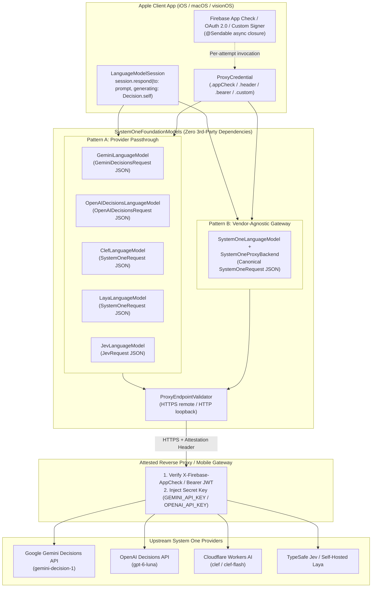

# ADR-2026-11-12-01: Universal Zero-Dependency Proxy Credentials & Hardware-Attested Mobile Gateways

- **Status**: Accepted / Implemented
- **Date**: 2026-11-12
- **Author**: Senior Architect Agent
- **PRD Reference**: `docs/prd/PRD-2026-11-12-universal-proxy-credentials.md`
- **Target Modules**: `SystemOneCore`, `GeminiFoundationModels`, `OpenAIFoundationModels`, `ClefFoundationModels`, `LayaFoundationModels`, `JevFoundationModels`, `SystemOneFoundationModels`
- **Target Release**: SystemOneFoundationModels 1.4.0 (iOS 27.0+, macOS 27.0+, visionOS 27.0+)

---

## 1. Context & Problem Statement

### 1.1 The Mobile Client Secret Vulnerability
Production mobile and desktop applications on iOS, macOS, and visionOS must never embed static upstream cloud API keys (`GEMINI_API_KEY`, `OPENAI_API_KEY`, `CLOUDFLARE_API_TOKEN`, `TYPESAFE_API_KEY`, or `HOSTED_VPC_TOKEN`) inside their compiled application binaries. Static secrets compiled into Mach-O binaries or bundled in `.plist` / `.env` resources are trivially extractable via static disassembly (`strings`, Hopper, Ghidra) or runtime TLS inspection on supervised/jailbroken devices (`mitmproxy`, Charles, Proxyman).

To eliminate client-side secret exposure, production applications route decision evaluations through an **authenticated reverse proxy or mobile gateway** (e.g., Firebase Cloud Functions v2 with Firebase App Check & Apple App Attest, Cloudflare Workers, Google Cloud Run, AWS API Gateway, or an enterprise Envoy/Kong ingress). The client attaches a short-lived, cryptographically attested token (such as an `X-Firebase-AppCheck` header or an OAuth 2.0 `Authorization: Bearer` token) to each request; the gateway verifies the attestation before injecting the upstream provider secret server-side.

### 1.2 Architectural Asymmetry Across System One Providers
Prior to this ADR, as documented in [Tech Note 0010](../../tech-notes/0010-proxy-transport-and-dynamic-attestation.md), only `JevFoundationModels` offered first-class reverse-proxy support via `ProxyTransport` and closure-based dynamic credential injection (`ProxyTransport.Credential`). Developers adopting any of the other System One providers faced three architectural limitations:

1. **Static-Only Credentials in Provider Modules**:
   - `GeminiDecisionsLanguageModel` (`GeminiLanguageModel`) and `GeminiDecisionsHTTPBackend` only accepted a static `apiKey: String?` (injected into `x-goog-api-key`) or read `GEMINI_API_KEY` / `GOOGLE_API_KEY` from process environment variables.
   - `OpenAIDecisionsLanguageModel` and `OpenAIDecisionsHTTPBackend` only accepted a static `apiKey: String?` (`Authorization: Bearer <key>`) or `OPENAI_API_KEY`.
   - `ClefLanguageModel` and `ClefHTTPBackend` only accepted a static `apiToken: String?`.
   - `LayaLanguageModel` and `LayaHTTPBackend` only accepted a static `apiKey: String?` without retry-aware dynamic credential evaluation.
2. **Stale or Consumed Tokens on Retry**:
   - Passing a short-lived App Check or OAuth token as a static string at model initialization causes failures after 30–60 minutes, or fails immediately on the second attempt when using single-use replay-protected tokens (`AppCheck.appCheck().limitedUseToken()`) after an HTTP `429 Too Many Requests` or `503 Service Unavailable` retry.
3. **Lack of a Vendor-Agnostic Gateway Backend in `SystemOneCore`**:
   - Teams building thin mobile clients that want to link *only* `SystemOneCore`—allowing their backend gateway to dynamically route, A/B test, or fail over between `gemini-decision-1`, `gpt-6-luna`, `clef`, and `jev-latest` server-side without an App Store binary update—lacked a built-in `SystemOneProxyBackend` and `SystemOneLanguageModel(proxyEndpoint:credential:modelID:...)` initializer.

### 1.3 Core Architectural Constraints
1. **Zero External Third-Party Runtime Dependencies (Principle 4 & Tech Note 0005)**: `Package.swift` must remain 100% pure Swift + Apple system frameworks (`Foundation`, `FoundationModels`, `UniformTypeIdentifiers`). Vendor SDKs (`FirebaseAppCheck`, `DeviceCheck`, OAuth libraries) must integrate via `@Sendable` async closures at the application call site.
2. **Swift 6 Strict Concurrency & `Hashable` Configuration Compliance**: Every `LanguageModel` implementation requires `Configuration: Hashable, Sendable`. Because `@Sendable` async closures cannot synthesize structural `Equatable` or `Hashable` conformance in Swift, `ProxyCredential` must provide identity-based `Hashable` conformance (matching `AnySystemOneBackend`).
3. **100% Source Backward Compatibility**: Existing `ProxyTransport` and `ProxyTransport.Credential` call sites in `JevFoundationModels` (including `ProxyTransportTests.swift` and `Examples/TraitSamples/05-SecureAppCheckApp`) must compile with zero source modifications.

---

## 2. Considered Options

### Decision Area 1: `ProxyCredential` Representation & `Hashable` Conformance (`SystemOneCore`)

- **Option 1A: Protocol `ProxyCredentialProvider` with Existential `any ProxyCredentialProvider`**:
  - *Description*: Define a protocol `ProxyCredentialProvider: Sendable` and store `any ProxyCredentialProvider` on backend configurations.
  - *Pros*: Open for custom conformances.
  - *Cons*: Existential `any ProxyCredentialProvider` does not conform to `Hashable`, breaking automatic `Hashable` synthesis on `GeminiDecisionsHTTPBackend`, `OpenAIDecisionsHTTPBackend`, `ClefHTTPBackend`, `LayaHTTPBackend`, and `LanguageModel.Configuration`. Prevents ergonomic leading-dot syntax (`.header(name: "X-Firebase-AppCheck") { ... }`).
- **Option 1B: `public enum ProxyCredential: Sendable` Without `Hashable`**:
  - *Description*: Move `ProxyTransport.Credential` directly to `SystemOneCore` as an enum with closure associated values, and manually implement `==` and `hash(into:)` on every HTTP backend struct by ignoring the credential property.
  - *Pros*: Preserves enum case syntax.
  - *Cons*: Two backends configured with different credentials would compare equal (`lhs == rhs`), violating value semantics for `LanguageModel.Configuration`. Forces repetitive boilerplate `Equatable`/`Hashable` implementations across 6 modules.
- **Option 1C: `public struct ProxyCredential: Sendable, Hashable` with Identity `UUID` and Static Factory Methods [Chosen]**:
  - *Description*:
    1. Define `public struct ProxyCredential: Sendable, Hashable` in `SystemOneCore` wrapping `private let id: UUID` and `private let modifier: @Sendable (inout URLRequest) async throws -> Void`.
    2. Provide static factory methods `.bearer(_:)`, `.header(name:prefix:provider:)`, and `.custom(_:)` with the exact parameter labels of `ProxyTransport.Credential`.
    3. Implement `Equatable` and `Hashable` via `id` (matching `AnySystemOneBackend` and `AnyJevTransport`).
    4. In `ProxyTransport`, define `public typealias Credential = ProxyCredential`. Because Swift resolves leading-dot expressions (`.bearer { ... }`, `.header(name: "...") { ... }`, `.custom { ... }`) identically for static factory methods and enum cases, all existing call sites compile without modification.
  - *Pros*: Automatic `Hashable` and `Equatable` synthesis for every HTTP backend and `LanguageModel.Configuration`; preserves leading-dot call-site ergonomics; 100% source compatibility with `ProxyTransport.Credential`; encapsulates header mutation logic inside `apply(to: &urlRequest)`.
  - *Cons*: None.

### Decision Area 2: Endpoint Security Validation (`ProxyEndpointValidator`)

- **Option 2A: Per-Backend Ad-Hoc URL Checks**:
  - *Description*: Duplicate scheme and host validation logic inside each of the 6 HTTP backends.
  - *Pros*: No shared validator type needed.
  - *Cons*: Risk of inconsistent IPv6 loopback handling (`::1` vs `[::1]`) or inconsistent error messages across modules.
- **Option 2B: Centralized `ProxyEndpointValidator` in `SystemOneCore` [Chosen]**:
  - *Description*:
    1. Create `public enum ProxyEndpointValidator` in `SystemOneCore` with `public static func validate(_ url: URL) throws`.
    2. Permit `https` for any non-empty host.
    3. Permit `http` strictly for loopback hosts (`"localhost"`, `"127.0.0.1"`, `"::1"`, `"[::1]"`), enabling local development against the Firebase Local Emulator Suite (`http://127.0.0.1:5001/...`), `wrangler dev` (`http://localhost:8787/...`), and `laya-serve` (`http://127.0.0.1:8000/...`).
    4. Throw `SystemOneError.networkError("Insecure proxy endpoint: HTTPS is required for remote proxy connections.")` for all other schemes or remote plaintext HTTP URLs.
    5. In `ProxyTransport`, catch `SystemOneError.networkError(let msg)` and rethrow `JevError.networkError(msg)` so existing tests expecting `JevError.self` (`ProxyTransportTests.testInsecureRemoteHTTPEndpointRejected`) continue to pass unchanged.
  - *Pros*: Single source of truth for fail-closed transport security; seamless local emulator ergonomics; preserves `JevError` contract in `ProxyTransport`.
  - *Cons*: Requires a 4-line error mapping in `ProxyTransport`.

### Decision Area 3: Pattern A — Provider Passthrough Proxy Architecture

- **Option 3A: Separate `ProxyBackend` Struct Per Provider Module**:
  - *Description*: Introduce `GeminiDecisionsProxyBackend`, `OpenAIDecisionsProxyBackend`, `ClefProxyBackend`, and `LayaProxyBackend` alongside the existing `*HTTPBackend` structs.
  - *Pros*: Separates direct and proxy code paths into distinct files.
  - *Cons*: Duplicates 90% of wire encoding, response decoding, server-timing extraction, error envelope parsing (`GeminiErrorEnvelope`, `OpenAIErrorEnvelope`, `CloudflareAPIEnvelope`), and `RetryPolicy` backoff loops across 4 modules.
- **Option 3B: Unified `proxyCredential: ProxyCredential?` Integration in Each Provider `*HTTPBackend` [Chosen]**:
  - *Description*:
    1. Add `public let proxyCredential: ProxyCredential?` (defaulting to `nil`) to `GeminiDecisionsHTTPBackend`, `OpenAIDecisionsHTTPBackend`, `ClefHTTPBackend`, and `LayaHTTPBackend`.
    2. Add dedicated `(proxyEndpoint: URL, credential: ProxyCredential, ...)` convenience initializers to both the `*HTTPBackend` and `*LanguageModel` types (plus `JevLanguageModel`).
    3. When `proxyCredential != nil`:
       - Validate `try ProxyEndpointValidator.validate(endpoint.url)` before entering the retry loop.
       - Bypass local static API key resolution (`resolveAPIKey()` is not required when `proxyCredential` is present; no `x-goog-api-key` or static `Authorization: Bearer` header is attached unless explicitly also provided).
       - Inside `performSingleEvaluation` (which executes on **every** retry attempt), invoke `try await proxyCredential.apply(to: &urlRequest)`.
  - *Pros*: Zero duplication of provider wire adapters, error envelope decoders, or telemetry parsers; guarantees per-attempt token refresh across HTTP 429/5xx retries; preserves multimodal image wire serialization (`GeminiDecisionsRequest` and `OpenAIDecisionsRequest`) end-to-end.
  - *Cons*: Slightly expands initializer surface on each `*HTTPBackend` and `*LanguageModel`.

### Decision Area 4: Pattern B — Vendor-Agnostic Canonical Gateway (`SystemOneProxyBackend`)

- **Option 4A: Require Pattern B Users to Import `LayaFoundationModels` or `JevFoundationModels`**:
  - *Description*: Direct developers who want a canonical `SystemOneRequest` proxy to use `LayaHTTPBackend` or `ProxyTransport`.
  - *Pros*: No new backend in `SystemOneCore`.
  - *Cons*: Forces thin client targets to enable `LayaServe` or `Jev` package traits; `LayaLanguageModel` and `JevLanguageModel` report `supportsDataAttachmentType == false`, blocking multimodal vision attachments (`SystemOneImage`) in Pattern B gateways.
- **Option 4B: First-Class `SystemOneProxyBackend` & Multimodal `SystemOneLanguageModel` in `SystemOneCore` [Chosen]**:
  - *Description*:
    1. Implement `public struct SystemOneProxyBackend: SystemOneBackend, Sendable, Hashable` in `SystemOneCore`.
    2. Update `SystemOneLanguageModel` and `SystemOneExecutor` in `SystemOneCore` to support multimodal vision attachments (`.png`, `.jpeg`, `.webP`) via `TranscriptAttachmentExtractor.extractImages(from: request.transcript)` and `DualSignalResponseSynthesizer`.
    3. Add `SystemOneLanguageModel.init(proxyEndpoint: URL, credential: ProxyCredential, modelID: String = "systemone-default", session: URLSession = .shared, timeoutInterval: TimeInterval = 30, retryPolicy: RetryPolicy = .default)`.
  - *Pros*: Pure `SystemOneCore` clients gain a complete, multimodal, hardware-attested gateway transport with zero provider-specific dependencies; enables server-side routing between Gemini, OpenAI, Clef, Jev, and Laya.
  - *Cons*: Requires wiring `TranscriptAttachmentExtractor` into `SystemOneExecutor`.

---

## 3. Decision Outcome

**Chosen Architecture**: We adopt **Option 1C**, **Option 2B**, **Option 3B**, and **Option 4B**.



---

## 4. Technical Architecture & Code-Level Specifications

### 4.1 `ProxyCredential` (`Sources/SystemOneCore/Backend/ProxyCredential.swift`)

`ProxyCredential` provides closure-based, per-attempt request authentication with identity-based `Hashable` conformance, including the `.appCheck` convenience shorthand and trailing-closure `authorize:` initializer overloads on all `LanguageModel` types:

```swift
import Foundation

/// A zero-dependency, concurrency-safe dynamic credential modifier for authenticating
/// against a backend proxy or mobile API gateway (e.g., Firebase App Check, DeviceCheck,
/// Cloudflare Access, or custom JWT providers).
///
/// `ProxyCredential` conforms to `Hashable` via an internal identity `UUID` so that
/// `LanguageModel.Configuration` and HTTP backend structs retain automatic `Hashable`
/// and `Sendable` synthesis.
///
/// See `docs/architecture/ADR-2026-11-12-01-universal-proxy-credentials.md` and
/// `tech-notes/0010-proxy-transport-and-dynamic-attestation.md`.
public struct ProxyCredential: Sendable, Hashable {
    private let id: UUID
    private let modifier: @Sendable (inout URLRequest) async throws -> Void

    public init(
        id: UUID = UUID(),
        modifier: @escaping @Sendable (inout URLRequest) async throws -> Void
    ) {
        self.id = id
        self.modifier = modifier
    }

    public static func == (lhs: ProxyCredential, rhs: ProxyCredential) -> Bool {
        lhs.id == rhs.id
    }

    public func hash(into hasher: inout Hasher) {
        hasher.combine(id)
    }

    /// Applies the credential mutation to an outbound `URLRequest`.
    /// Invoked on every attempt (including retries) so short-lived or rotating tokens stay fresh.
    public func apply(to request: inout URLRequest) async throws {
        try await modifier(&request)
    }

    /// Sets `Authorization: Bearer <token>` using the dynamically resolved token.
    public static func bearer(
        _ provider: @escaping @Sendable () async throws -> String
    ) -> ProxyCredential {
        ProxyCredential { request in
            let token = try await provider()
            request.setValue("Bearer \(token)", forHTTPHeaderField: "Authorization")
        }
    }

    /// Sets a custom HTTP header with an optional prefix (e.g. `X-Firebase-AppCheck: <token>`).
    public static func header(
        name: String,
        prefix: String? = nil,
        provider: @escaping @Sendable () async throws -> String
    ) -> ProxyCredential {
        ProxyCredential { request in
            let token = try await provider()
            let value = prefix.map { "\($0) \(token)" } ?? token
            request.setValue(value, forHTTPHeaderField: name)
        }
    }

    /// Sets an attestation header (defaults to `X-Firebase-AppCheck`) using a dynamically resolved token.
    ///
    /// Zero-dependency convenience shorthand: the caller provides an async closure calling
    /// `AppCheck.appCheck().token(forcingRefresh: false).token` without `SystemOneCore`
    /// linking `FirebaseAppCheck`.
    public static func appCheck(
        headerName: String = "X-Firebase-AppCheck",
        _ provider: @escaping @Sendable () async throws -> String
    ) -> ProxyCredential {
        .header(name: headerName, provider: provider)
    }

    /// Applies arbitrary modifications to the outbound `URLRequest` before dispatch
    /// (e.g. combining `X-Firebase-AppCheck` with a user `Authorization: Bearer` header).
    public static func custom(
        _ modifier: @escaping @Sendable (inout URLRequest) async throws -> Void
    ) -> ProxyCredential {
        ProxyCredential(modifier: modifier)
    }
}
```

In addition to `init(proxyEndpoint: URL, credential: ProxyCredential, ...)`, every hosted `LanguageModel` (`GeminiDecisionsLanguageModel`, `OpenAIDecisionsLanguageModel`, `ClefLanguageModel`, `LayaLanguageModel`, `JevLanguageModel`, and `SystemOneLanguageModel`) provides an inline trailing-closure `authorize:` initializer that delegates to `.custom(authorize)`:

```swift
public init(
    proxyEndpoint: URL,
    ...,
    authorize: @escaping @Sendable (inout URLRequest) async throws -> Void
)
```

---

### 4.2 `ProxyEndpointValidator` (`Sources/SystemOneCore/Backend/ProxyEndpointValidator.swift`)

`ProxyEndpointValidator` enforces fail-closed TLS (`https://`) for all remote proxy endpoints while allowing plaintext `http://` strictly for local loopback emulators:

```swift
import Foundation

/// Validates proxy endpoint URLs to ensure dynamic attestation tokens and payloads
/// are never transmitted over unencrypted remote connections.
public enum ProxyEndpointValidator: Sendable {
    private static let allowedLoopbackHosts: Set<String> = [
        "localhost",
        "127.0.0.1",
        "::1",
        "[::1]"
    ]

    /// Validates that `url` uses `https://`, or `http://` targeting a local loopback interface.
    ///
    /// - Parameter url: The target proxy endpoint URL.
    /// - Throws: `SystemOneError.networkError` if the endpoint uses an insecure scheme for a remote host.
    public static func validate(_ url: URL) throws {
        let scheme = url.scheme?.lowercased()
        if scheme == "https", let host = url.host, !host.isEmpty {
            return
        }
        if scheme == "http", let host = url.host?.lowercased(), allowedLoopbackHosts.contains(host) {
            return
        }
        throw SystemOneError.networkError(
            "Insecure proxy endpoint: HTTPS is required for remote proxy connections."
        )
    }
}
```

---

### 4.3 `SystemOneProxyBackend` & `SystemOneLanguageModel` (`SystemOneCore` — Pattern B)

#### 1. `SystemOneProxyBackend` (`Sources/SystemOneCore/Backend/SystemOneProxyBackend.swift`)

```swift
import Foundation

/// A vendor-agnostic HTTP backend that dispatches canonical `SystemOneRequest` payloads
/// to an authenticated reverse proxy or enterprise gateway.
///
/// Use `SystemOneProxyBackend` (or `SystemOneLanguageModel(proxyEndpoint:credential:modelID:)`)
/// when your backend gateway translates or routes between upstream System One providers
/// (`gemini-decision-1`, `gpt-6-luna`, `clef`, `jev-latest`, or `laya-serve`) server-side.
public struct SystemOneProxyBackend: SystemOneBackend, Sendable, Hashable {
    public let proxyEndpoint: URL
    public let credential: ProxyCredential
    public let session: URLSession
    public let timeoutInterval: TimeInterval
    public let retryPolicy: RetryPolicy

    public init(
        proxyEndpoint: URL,
        credential: ProxyCredential,
        session: URLSession = .shared,
        timeoutInterval: TimeInterval = 30,
        retryPolicy: RetryPolicy = .default
    ) {
        self.proxyEndpoint = proxyEndpoint
        self.credential = credential
        self.session = session
        self.timeoutInterval = timeoutInterval
        self.retryPolicy = retryPolicy
    }

    private struct HTTPResponseError: Error {
        let httpResponse: HTTPURLResponse
        let data: Data
    }

    public func evaluate(request: SystemOneRequest) async throws -> SystemOneResponse {
        try ProxyEndpointValidator.validate(proxyEndpoint)

        let requestData: Data
        do {
            requestData = try JSONEncoder().encode(request)
        } catch {
            throw SystemOneError.decodingError("Failed to serialize SystemOneRequest: \(error.localizedDescription)")
        }

        var attempts = 0
        let maxAttempts = retryPolicy.maxAttempts

        while true {
            attempts += 1
            do {
                return try await performSingleEvaluation(requestData: requestData)
            } catch is CancellationError {
                throw CancellationError()
            } catch let resError as HTTPResponseError {
                let statusCode = resError.httpResponse.statusCode
                let body = String(data: resError.data, encoding: .utf8) ?? "HTTP error \(statusCode)"

                if statusCode == 401 || statusCode == 403 {
                    throw SystemOneError.authenticationFailed(body)
                }

                let isLastAttempt = attempts >= maxAttempts
                guard retryPolicy.retryableStatuses.contains(statusCode), !isLastAttempt else {
                    throw SystemOneError.apiError(statusCode: statusCode, message: body)
                }

                let delay: Duration
                if statusCode == 429, let retryAfterDelay = retryPolicy.retryAfter(from: resError.httpResponse) {
                    delay = retryAfterDelay
                } else {
                    delay = retryPolicy.backoff(afterAttempt: attempts)
                }

                try await Task.sleep(for: delay)
                continue
            } catch let error as SystemOneError {
                switch error {
                case .networkError:
                    if attempts < maxAttempts && !Task.isCancelled {
                        let delay = retryPolicy.backoff(afterAttempt: attempts)
                        try await Task.sleep(for: delay)
                        continue
                    }
                    throw error
                default:
                    throw error
                }
            } catch {
                if attempts < maxAttempts && !Task.isCancelled {
                    let delay = retryPolicy.backoff(afterAttempt: attempts)
                    try await Task.sleep(for: delay)
                    continue
                }
                throw SystemOneError.networkError(error.localizedDescription)
            }
        }
    }

    private func performSingleEvaluation(requestData: Data) async throws -> SystemOneResponse {
        var urlRequest = URLRequest(url: proxyEndpoint)
        urlRequest.httpMethod = "POST"
        urlRequest.setValue("application/json", forHTTPHeaderField: "Content-Type")
        urlRequest.setValue("application/json", forHTTPHeaderField: "Accept")
        urlRequest.timeoutInterval = timeoutInterval
        urlRequest.httpBody = requestData

        do {
            try await credential.apply(to: &urlRequest)
        } catch is CancellationError {
            throw CancellationError()
        }

        let clock = ContinuousClock()
        let networkStart = clock.now
        let data: Data
        let urlResponse: URLResponse
        do {
            (data, urlResponse) = try await session.data(for: urlRequest)
        } catch is CancellationError {
            throw CancellationError()
        } catch let urlError as URLError where urlError.code == .cancelled {
            throw CancellationError()
        } catch {
            if (error as? URLError)?.code == .cancelled || error is CancellationError {
                throw CancellationError()
            }
            throw SystemOneError.networkError(error.localizedDescription)
        }

        let elapsed = networkStart.duration(to: clock.now)
        let transportDuration = Double(elapsed.components.seconds) * 1000.0 + Double(elapsed.components.attoseconds) / 1e15

        guard let httpResponse = urlResponse as? HTTPURLResponse else {
            throw SystemOneError.networkError("Invalid HTTP response received from proxy gateway.")
        }

        guard (200...299).contains(httpResponse.statusCode) else {
            throw HTTPResponseError(httpResponse: httpResponse, data: data)
        }

        do {
            var decoded = try JSONDecoder().decode(SystemOneResponse.self, from: data)
            decoded.transportDurationMs = transportDuration
            if let serverMs = Self.parseServerDuration(from: httpResponse) {
                decoded.serverDurationMs = serverMs
            } else if decoded.serverDurationMs == nil {
                decoded.serverDurationMs = transportDuration
            }
            return decoded
        } catch {
            throw SystemOneError.decodingError("Failed to decode SystemOneResponse from proxy: \(error.localizedDescription)")
        }
    }

    private static func parseServerDuration(from response: HTTPURLResponse) -> Double? {
        for header in ["x-goog-processing-ms", "openai-processing-ms", "x-envoy-upstream-service-time", "x-inference-time-ms"] {
            if let val = response.value(forHTTPHeaderField: header), let ms = Double(val) {
                return ms
            }
        }
        if let serverTiming = response.value(forHTTPHeaderField: "server-timing") {
            for entry in serverTiming.components(separatedBy: ",") {
                for param in entry.components(separatedBy: ";").dropFirst() {
                    let kv = param.trimmingCharacters(in: .whitespaces).components(separatedBy: "=")
                    if kv.count == 2 && kv[0] == "dur", let dur = Double(kv[1]) {
                        return dur
                    }
                }
            }
        }
        return nil
    }
}
```

#### 2. `SystemOneLanguageModel` & `SystemOneExecutor` Updates (`Sources/SystemOneCore/`)
`SystemOneLanguageModel` gains a first-class proxy initializer and declares `[.guidedGeneration, .vision]` capabilities so multimodal image prompts can be routed through `SystemOneProxyBackend`:

```swift
extension SystemOneLanguageModel {
    public init(
        proxyEndpoint: URL,
        credential: ProxyCredential,
        modelID: String = "systemone-default",
        session: URLSession = .shared,
        timeoutInterval: TimeInterval = 30,
        retryPolicy: RetryPolicy = .default
    ) {
        let backend = SystemOneProxyBackend(
            proxyEndpoint: proxyEndpoint,
            credential: credential,
            session: session,
            timeoutInterval: timeoutInterval,
            retryPolicy: retryPolicy
        )
        self.executorConfiguration = Configuration(
            backend: AnySystemOneBackend(backend),
            modelID: modelID
        )
    }
}
```

In `SystemOneExecutor.respond(to:model:streamingInto:)`, image attachments are extracted via `TranscriptAttachmentExtractor().extractImages(from: request.transcript)` and passed to `SystemOneRequest(state:model:questions:images: extractedImages.isEmpty ? nil : extractedImages)`.

---

### 4.4 Pattern A — Provider Passthrough Proxy Specifications

#### 1. `GeminiFoundationModels` (`GeminiDecisionsHTTPBackend` & `GeminiDecisionsLanguageModel`)

In `GeminiDecisionsHTTPBackend`:
- Add `public let proxyCredential: ProxyCredential?` (default `nil`).
- Add proxy convenience initializer:
  ```swift
  public init(
      proxyEndpoint: URL,
      credential: ProxyCredential,
      model: String = GeminiDecisionsEndpoint.defaultModel,
      clientRequestID: String? = nil,
      session: URLSession = .shared,
      timeoutInterval: TimeInterval = 30,
      retryPolicy: RetryPolicy = .default
  ) {
      self.endpoint = .custom(proxyEndpoint, model: model, clientRequestID: clientRequestID)
      self.apiKey = nil
      self.proxyCredential = credential
      self.session = session
      self.timeoutInterval = timeoutInterval
      self.retryPolicy = retryPolicy
      self.environmentOverride = nil
  }
  ```
- In `evaluateWithTiming(request:)`:
  - When `proxyCredential != nil`:
    1. Call `try ProxyEndpointValidator.validate(endpoint.url)` before entering the retry loop.
    2. Do **not** require `resolveAPIKey()` to be non-nil (only pass an explicit `apiKey` if the caller intentionally provided one; do not read `GEMINI_API_KEY` or `GOOGLE_API_KEY` from the environment when `proxyCredential != nil`).
  - When `proxyCredential == nil`:
    1. Preserve existing behavior (`guard let resolvedKey = resolveAPIKey() else { throw SystemOneError.missingAPIKey }`).
- In `performSingleEvaluation(request:apiKey:)`:
  - Set `x-goog-api-key` only if `let apiKey = apiKey, !apiKey.isEmpty`.
  - If `let proxyCredential = proxyCredential`, call `try await proxyCredential.apply(to: &urlRequest)` on every attempt before `session.data(for: urlRequest)`.

In `GeminiDecisionsLanguageModel` (`GeminiLanguageModel`):
- Add convenience initializer on `Configuration` and `GeminiDecisionsLanguageModel`:
  ```swift
  public init(
      proxyEndpoint: URL,
      credential: ProxyCredential,
      model: String = GeminiDecisionsEndpoint.defaultModel,
      clientRequestID: String? = nil,
      session: URLSession = .shared,
      timeoutInterval: TimeInterval = 30,
      retryPolicy: RetryPolicy = .default
  )
  ```

#### 2. `OpenAIFoundationModels` (`OpenAIDecisionsHTTPBackend` & `OpenAIDecisionsLanguageModel`)

In `OpenAIDecisionsHTTPBackend`:
- Add `public let proxyCredential: ProxyCredential?` (default `nil`).
- Add proxy convenience initializer:
  ```swift
  public init(
      proxyEndpoint: URL,
      credential: ProxyCredential,
      model: String = OpenAIDecisionsEndpoint.defaultModel,
      organization: String? = nil,
      project: String? = nil,
      clientRequestID: String? = nil,
      session: URLSession = .shared,
      timeoutInterval: TimeInterval = 30,
      retryPolicy: RetryPolicy = .default
  )
  ```
- In `evaluateWithTiming(request:)`:
  - When `proxyCredential != nil`, validate `try ProxyEndpointValidator.validate(endpoint.url)` and bypass `OPENAI_API_KEY` resolution.
- In `performSingleEvaluation(request:apiKey:)`:
  - Set `Authorization: Bearer \(apiKey)` only when `apiKey` is non-nil, then apply `try await proxyCredential.apply(to: &urlRequest)` inside the per-attempt execution.

In `OpenAIDecisionsLanguageModel`:
- Add matching `init(proxyEndpoint:credential:model:organization:project:clientRequestID:session:timeoutInterval:retryPolicy:)`.

#### 3. `ClefFoundationModels` (`ClefHTTPBackend` & `ClefLanguageModel`)

In `ClefHTTPBackend`:
- Add `public let proxyCredential: ProxyCredential?` (default `nil`).
- Add `init(proxyEndpoint: URL, model: ClefModel = .clefFlash, credential: ProxyCredential, session: URLSession = .shared, timeoutInterval: TimeInterval = 45, retryPolicy: RetryPolicy = .default)`.
- In `evaluate(request:)`, if `proxyCredential != nil`, validate `try ProxyEndpointValidator.validate(endpoint.url)`.
- In `performSingleEvaluation(request:)`, if `let proxyCredential = proxyCredential`, invoke `try await proxyCredential.apply(to: &urlRequest)` inside each retry attempt.

In `ClefLanguageModel`:
- Add `init(proxyEndpoint: URL, model: ClefModel = .clefFlash, credential: ProxyCredential, session: URLSession = .shared, timeoutInterval: TimeInterval = 45, retryPolicy: RetryPolicy = .default)`.

#### 4. `LayaFoundationModels` (`LayaHTTPBackend` & `LayaLanguageModel`)

In `LayaHTTPBackend`:
- Add `public let proxyCredential: ProxyCredential?` (default `nil`) and `public let retryPolicy: RetryPolicy` (default `.default`).
- Add `init(proxyEndpoint: URL, credential: ProxyCredential, session: URLSession = .shared, timeoutInterval: TimeInterval = 30, retryPolicy: RetryPolicy = .default)`.
- Upgrade `LayaHTTPBackend.evaluate(request:)` to execute inside a `RetryPolicy` loop matching `ClefHTTPBackend` and `SystemOneProxyBackend`, validating `ProxyEndpointValidator.validate(endpoint.url)` when `proxyCredential != nil` and calling `try await proxyCredential.apply(to: &urlRequest)` on each attempt.

In `LayaLanguageModel`:
- Add `init(proxyEndpoint: URL, modelID: String = "english", credential: ProxyCredential, session: URLSession = .shared, timeoutInterval: TimeInterval = 30, retryPolicy: RetryPolicy = .default)`.

#### 5. `JevFoundationModels` (`ProxyTransport` & `JevLanguageModel`)

In `ProxyTransport`:
- Replace the nested `Credential` enum definition with:
  ```swift
  /// Authentication mechanisms supported by the proxy gateway.
  public typealias Credential = ProxyCredential
  ```
- Delegate endpoint validation to `ProxyEndpointValidator.validate(proxyEndpoint)`, mapping `SystemOneError.networkError(let message)` to `JevError.networkError(message)` so `ProxyTransportTests.testInsecureRemoteHTTPEndpointRejected` preserves its exact `JevError` contract.
- Delegate credential application to `try await credential.apply(to: &urlRequest)`.

In `JevLanguageModel`:
- Add convenience initializer:
  ```swift
  public init(
      proxyEndpoint: URL,
      credential: ProxyCredential,
      modelID: String = "jev-latest",
      session: URLSession = .shared,
      timeoutInterval: TimeInterval = 30,
      retryPolicy: RetryPolicy = .default
  ) {
      let transport = ProxyTransport(
          proxyEndpoint: proxyEndpoint,
          credential: credential,
          session: session,
          timeoutInterval: timeoutInterval,
          retryPolicy: retryPolicy
      )
      self.executorConfiguration = Configuration(
          apiKey: nil,
          modelID: modelID,
          endpoint: proxyEndpoint,
          transport: AnyJevTransport(transport)
      )
  }
  ```

---

## 5. Verification & Testing Strategy

All unit tests must execute 100% offline using hermetic `URLProtocol` subclasses and Swift Testing (`@Suite`, `@Test`, `#expect`):

| Target Test Suite | Key Verification Scenarios |
| :--- | :--- |
| **`SystemOneCoreTests`** (`ProxyCredentialTests.swift`) | 1. `ProxyCredential` `.bearer`, `.header(name:prefix:)`, and `.custom` request mutation.<br>2. `ProxyEndpointValidator` rejects remote `http://` and non-HTTP schemes while permitting `https://`, `http://localhost`, `http://127.0.0.1`, and `http://[::1]`.<br>3. `SystemOneProxyBackend` & `SystemOneLanguageModel(proxyEndpoint:credential:)` end-to-end evaluation, multimodal image transmission, and per-attempt token rotation on HTTP `429` $\to$ `200`. |
| **`GeminiFoundationModelsTests`** | 1. `GeminiLanguageModel(proxyEndpoint:credential:)` succeeds without `GEMINI_API_KEY` or `GOOGLE_API_KEY` in environment and omits `x-goog-api-key`.<br>2. Per-attempt token rotation (`token-1` on 429, `token-2` on 200).<br>3. Rejects remote `http://` proxy URLs and permits `http://127.0.0.1:5001` emulator URLs. |
| **`OpenAIFoundationModelsTests`** | 1. `OpenAIDecisionsLanguageModel(proxyEndpoint:credential:)` succeeds without `OPENAI_API_KEY` in environment.<br>2. Per-attempt token rotation on HTTP `429` $\to$ `200` and HTTPS validation. |
| **`ClefFoundationModelsTests`** | 1. `ClefLanguageModel(proxyEndpoint:model:credential:)` attaches dynamic header per attempt and validates HTTPS / loopback. |
| **`LayaFoundationModelsTests`** | 1. `LayaLanguageModel(proxyEndpoint:modelID:credential:)` attaches dynamic header per attempt across retries and validates HTTPS / loopback. |
| **`JevFoundationModelsTests`** | 1. Existing `ProxyTransportTests` pass with zero modifications.<br>2. `JevLanguageModel(proxyEndpoint:credential:)` convenience initializer dispatches through `ProxyTransport` and rotates tokens on retry. |
